# 🪣 Amazon S3 — Armazenamento, Versionamento e Gerenciamento

## 📋 Visão Geral

Este laboratório demonstra a utilização do **Amazon S3** para armazenamento, organização, segurança e gerenciamento de objetos.

Durante o laboratório, foram aplicadas práticas de **bloqueio de acesso público, versionamento de objetos, regras de ciclo de vida, URLs pré-assinadas e registro de logs de acesso ao servidor**.

O objetivo é compreender como o Amazon S3 pode ser configurado para proporcionar maior segurança, controle sobre versões de arquivos e otimização dos custos de armazenamento.

---

## 🎯 Objetivos

* Criar e configurar um bucket no Amazon S3
* Aplicar configurações básicas de segurança
* Realizar upload de objetos
* Habilitar o versionamento de objetos
* Criar e gerenciar diferentes versões de um arquivo
* Configurar uma regra de ciclo de vida
* Utilizar o Glacier Instant Retrieval para transição de objetos
* Criar e testar uma URL pré-assinada
* Criar um bucket para armazenamento de logs
* Configurar o registro de logs de acesso ao servidor

---

## ☁️ Serviço AWS Utilizado

### Amazon S3

O **Amazon Simple Storage Service (Amazon S3)** é um serviço de armazenamento de objetos altamente escalável, utilizado para armazenar e proteger diferentes tipos de dados.

Neste laboratório, foram explorados recursos do S3 relacionados à **segurança, versionamento, gerenciamento do ciclo de vida, compartilhamento temporário de objetos e monitoramento de acessos**.

---

## ⚙️ Implementação

### 1. Criar o bucket

Primeiramente, foi iniciado o processo de criação de um novo bucket no **Amazon S3**.

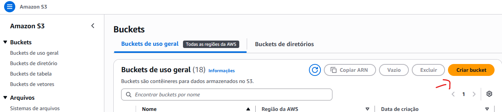

---

### 2. Definir o nome do bucket

Foi definido um nome único para o bucket, seguindo as regras de nomenclatura do Amazon S3.

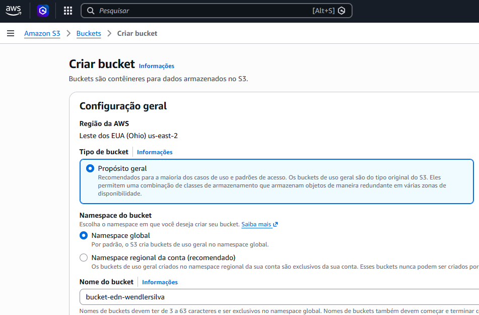

---

### 3. Manter ACLs desabilitadas

As **ACLs (Access Control Lists)** foram mantidas desabilitadas, seguindo a configuração recomendada pelo Amazon S3 para utilizar políticas baseadas em IAM e recursos do próprio S3 para controle de acesso.

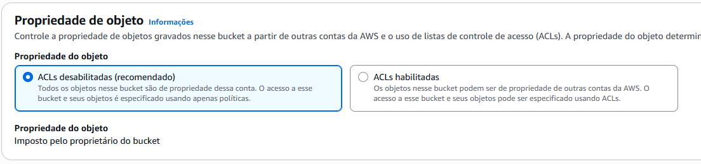

---

### 4. Bloquear acesso público

O bloqueio de acesso público foi mantido habilitado.

Essa configuração ajuda a evitar que objetos do bucket sejam expostos publicamente de forma acidental.

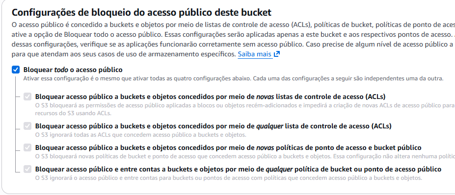

---

### 5. Confirmar a criação do bucket

Após revisar as configurações, o bucket foi criado com sucesso.

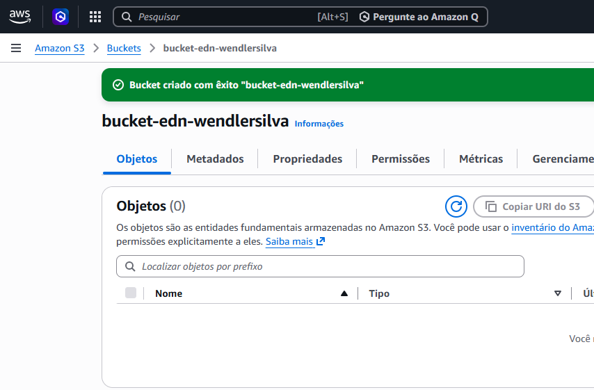

---

## 📦 Upload de Arquivos

### 6. Criar o arquivo de teste

Para testar o armazenamento e posteriormente o versionamento, foi criado um arquivo chamado `Lab9.txt` contendo a primeira versão do conteúdo.

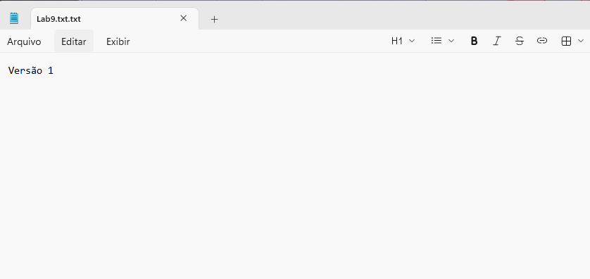

---

### 7. Fazer upload do arquivo

O arquivo foi enviado para o bucket criado anteriormente.

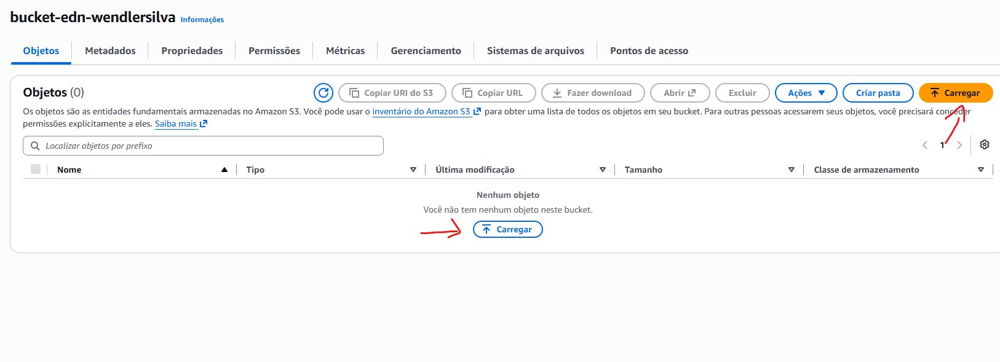

Após selecionar o arquivo, ele foi adicionado ao processo de upload.

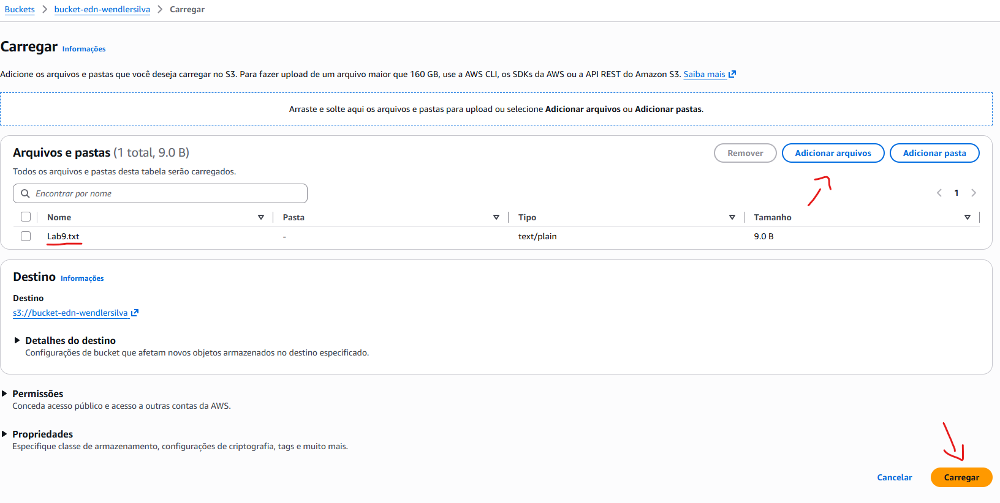

O upload foi concluído com sucesso e o objeto passou a estar disponível no bucket.

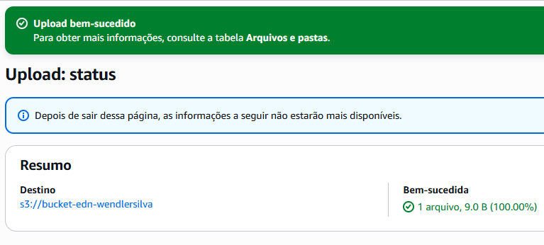

---

## 🔄 Versionamento do Bucket

### 8. Acessar as propriedades do bucket

Para habilitar o versionamento, foi acessada a área de **Propriedades** do bucket.

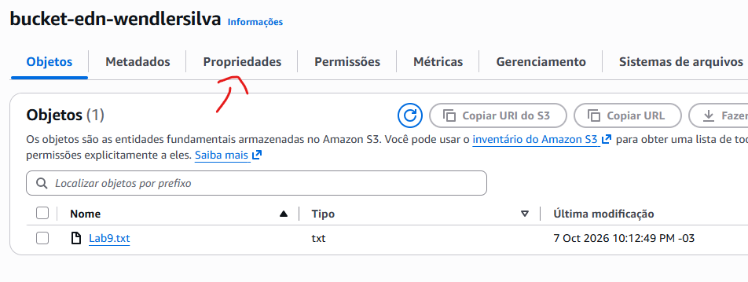

---

### 9. Localizar as configurações de versionamento

Dentro das propriedades, foi localizada a seção responsável pelo **Versionamento de bucket**.

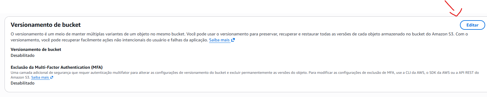

---

### 10. Ativar o versionamento

O versionamento foi ativado para permitir que diferentes versões do mesmo objeto fossem armazenadas pelo Amazon S3.

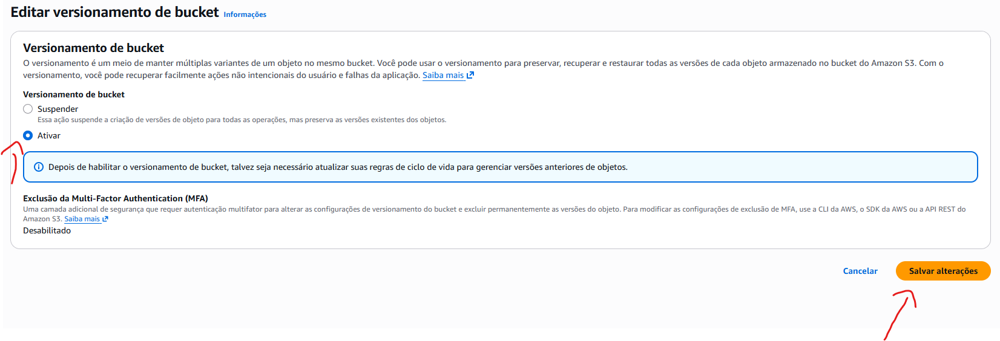

---

### 11. Criar uma nova versão do arquivo

O arquivo `Lab9.txt` foi alterado para representar uma segunda versão.

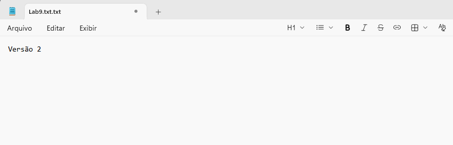

A nova versão do arquivo foi enviada novamente para o mesmo bucket.

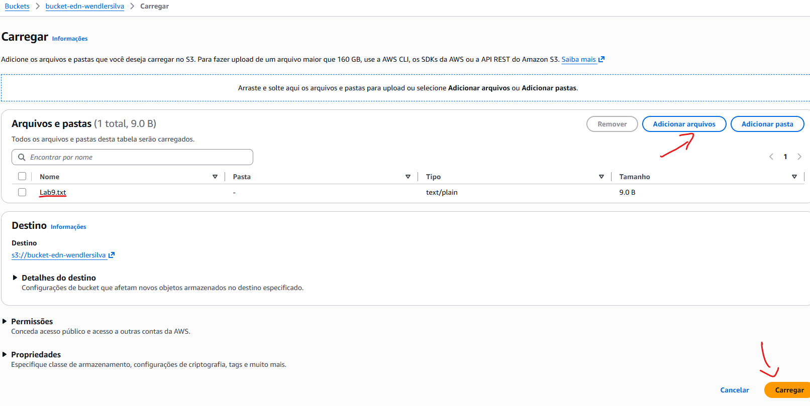

Com o versionamento habilitado, o Amazon S3 mantém as versões anteriores do objeto em vez de simplesmente substituí-las.

---

## ♻️ Regra de Ciclo de Vida

### 12. Acessar o gerenciamento do bucket

Para configurar a automação do armazenamento, foi acessada a seção **Gerenciamento** do bucket.

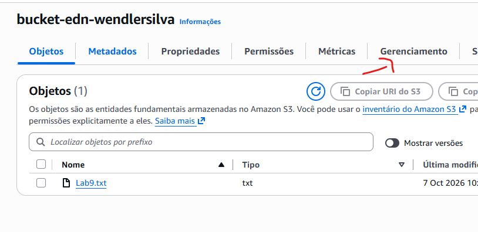

---

### 13. Criar uma regra de ciclo de vida

Foi iniciada a criação de uma nova **Regra de ciclo de vida** para automatizar o gerenciamento dos objetos armazenados.

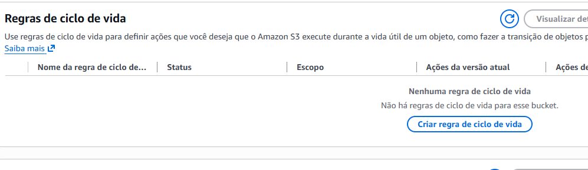

---

### 14. Definir o nome da regra

Foi definido um nome para identificar a finalidade da regra de ciclo de vida.

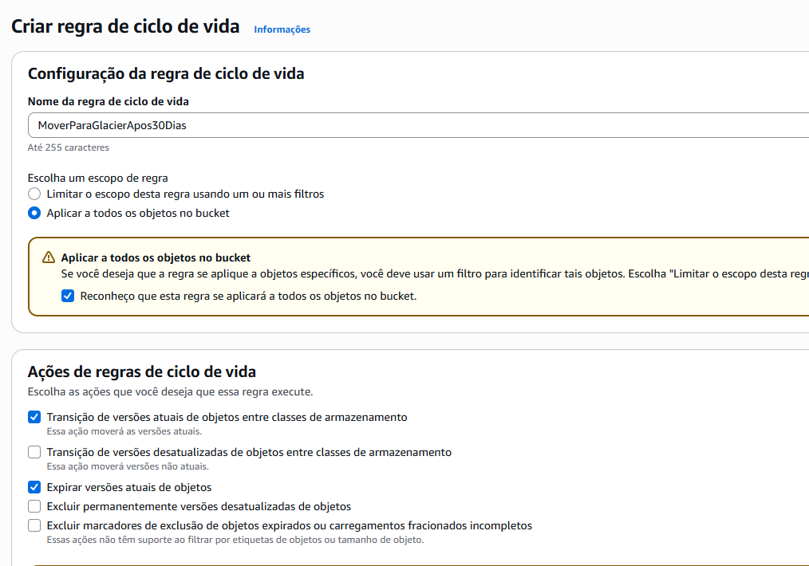

---

### 15. Configurar a transição de armazenamento

A regra foi configurada para realizar a transição dos objetos para a classe **Glacier Instant Retrieval** após o período definido no laboratório.

Essa configuração permite automatizar a movimentação de dados para uma classe de armazenamento adequada a objetos que não precisam ser acessados com frequência.

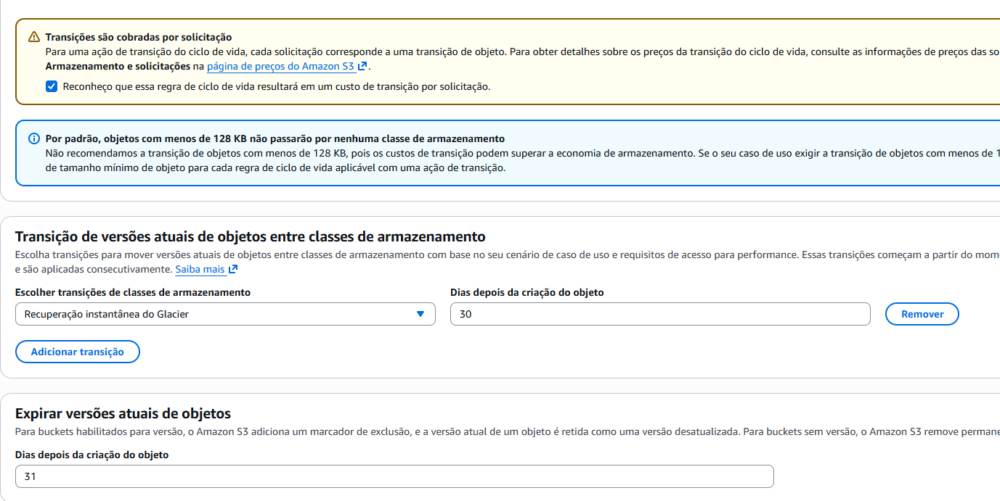

---

### 16. Finalizar a regra de ciclo de vida

Após revisar as configurações, a regra foi criada com sucesso.

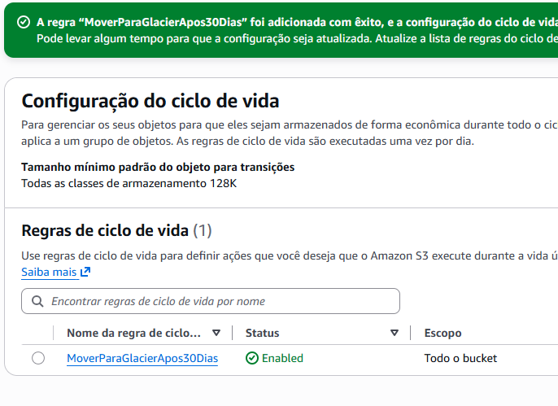

A utilização de regras de ciclo de vida permite automatizar o gerenciamento dos objetos e contribuir para a otimização dos custos de armazenamento.

---

## 🔗 URLs Pré-assinadas

### 17. Criar uma URL pré-assinada

Foi acessado o objeto armazenado no bucket para iniciar a criação de uma **URL pré-assinada**.

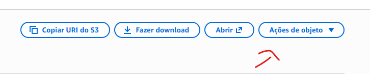

---

### 18. Definir o tempo de expiração

Foi definido um período de validade para a URL pré-assinada.

Esse recurso permite conceder acesso temporário a um objeto privado sem precisar tornar o bucket ou o objeto público.

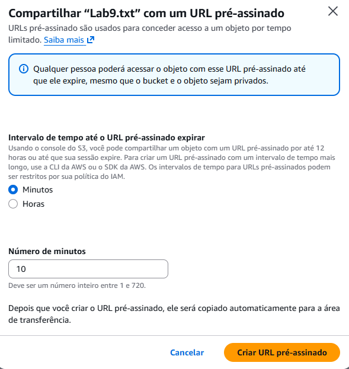

---

### 19. Testar a URL pré-assinada

A URL gerada foi utilizada para validar o acesso temporário ao objeto.

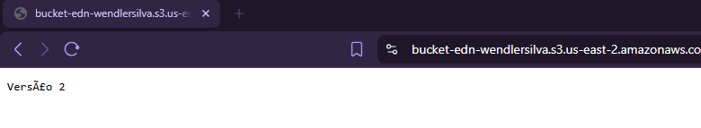

Após o período de expiração configurado, a URL deixa de permitir o acesso ao objeto.

---

## 📊 Logs de Acesso ao Servidor

### 20. Criar o bucket para os logs

Foi criado um segundo bucket destinado ao armazenamento dos **logs de acesso ao servidor**.

Esse bucket será utilizado como destino dos registros gerados pelo primeiro bucket.

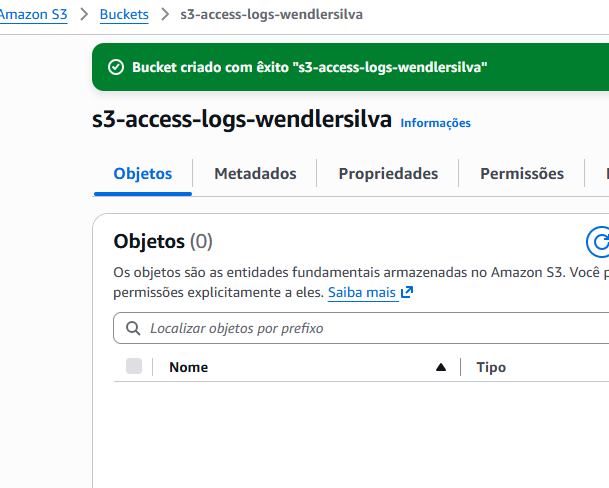

---

### 21. Acessar as propriedades do bucket

Para configurar o registro de acesso, foi acessada novamente a seção **Propriedades** do primeiro bucket.

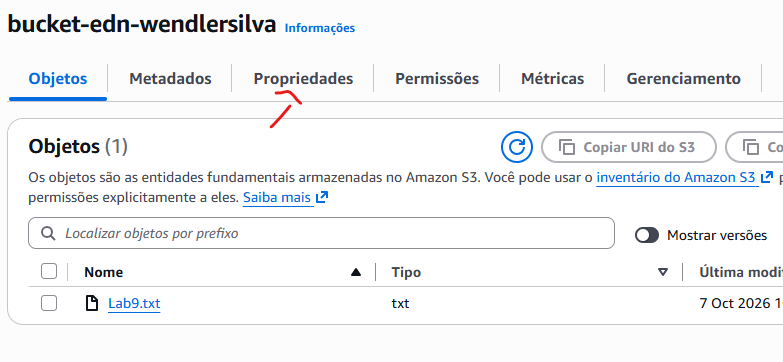

---

### 22. Localizar o registro de logs do servidor

Dentro das propriedades, foi localizada a seção **Registro em log de acesso ao servidor**.

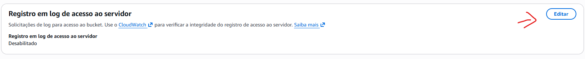

---

### 23. Configurar o destino dos logs

O registro de logs de acesso foi habilitado e o segundo bucket foi definido como destino para armazenamento dos registros.

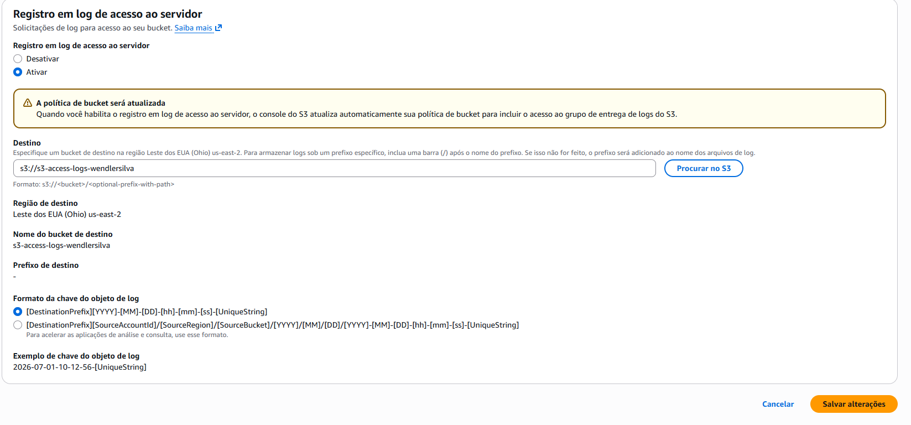

Após essa configuração, os acessos realizados no bucket podem gerar registros que serão armazenados no bucket destinado aos logs.

---

## 🧪 Validação

Durante o laboratório, foi possível validar:

* Criação e configuração de um bucket no Amazon S3
* Bloqueio de acesso público
* Utilização de ACLs desabilitadas
* Upload de objetos
* Versionamento de objetos
* Criação de diferentes versões do mesmo arquivo
* Configuração de regras de ciclo de vida
* Transição de objetos para **Glacier Instant Retrieval**
* Criação e utilização de URLs pré-assinadas
* Criação de um bucket destinado aos logs
* Configuração do registro de logs de acesso ao servidor

---

## 📚 Principais aprendizados

Este laboratório permitiu compreender na prática como o **Amazon S3** pode ser utilizado não apenas para armazenar arquivos, mas também para implementar estratégias de **segurança, controle de versões, automação e otimização de custos**.

Também foi possível compreender como **URLs pré-assinadas** permitem fornecer acesso temporário a objetos privados e como os **logs de acesso** podem auxiliar no monitoramento das operações realizadas nos buckets.

Esses recursos são importantes para projetar soluções de armazenamento mais **seguras, organizadas, monitoráveis e eficientes em custos** na AWS.
