# AWS EC2, Auto Scaling Group e Application Load Balancer

## Objetivo

Neste laboratório, foi implementado um ambiente web de alta disponibilidade na AWS utilizando Amazon EC2, Launch Templates, Auto Scaling Groups (ASG) e Application Load Balancer (ALB).

O objetivo foi distribuir o tráfego entre duas instâncias EC2 localizadas em diferentes Zonas de Disponibilidade, aumentando a disponibilidade da aplicação e permitindo a recuperação automática em caso de falha de uma instância.

## Arquitetura implementada

- **Amazon EC2:** instâncias que executam o servidor web Apache.
- **Launch Template:** modelo com as configurações utilizadas para criar as instâncias.
- **Auto Scaling Group:** gerenciamento automático do ciclo de vida e da quantidade de instâncias.
- **Application Load Balancer:** distribuição das requisições HTTP entre as instâncias.
- **Security Group:** controle do tráfego de entrada.
- **Duas Zonas de Disponibilidade:** distribuição das instâncias para melhorar a tolerância a falhas.

## 1. Criação do Security Group

Inicialmente, foi criado um Security Group para controlar o acesso às instâncias EC2. Foram configuradas regras de entrada para permitir tráfego HTTP e HTTPS, conforme as etapas do laboratório.

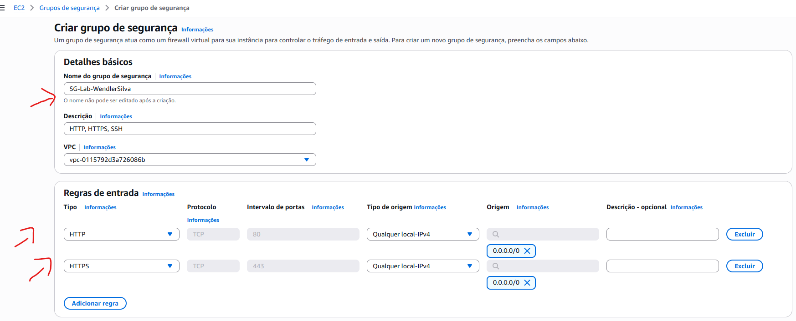

## 2. Criação do Launch Template

O Launch Template define as configurações utilizadas na inicialização das instâncias EC2, padronizando a criação dos servidores web.

Foi configurado um modelo utilizando a imagem Amazon Linux 2023, instância do tipo `t2.micro` e o Security Group criado anteriormente.

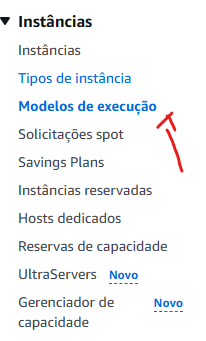

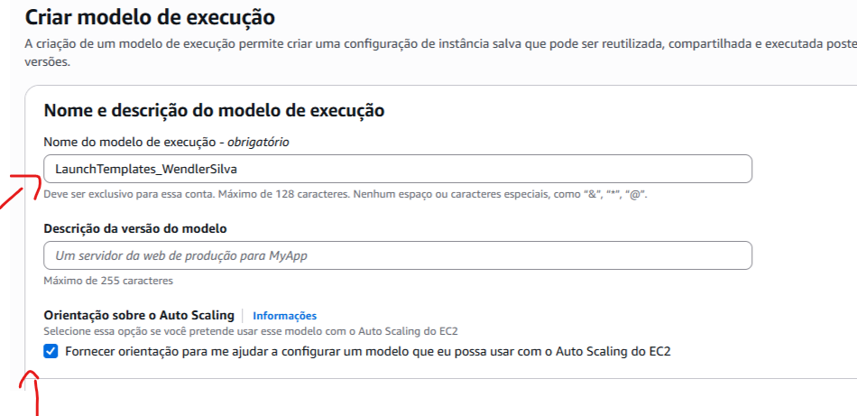

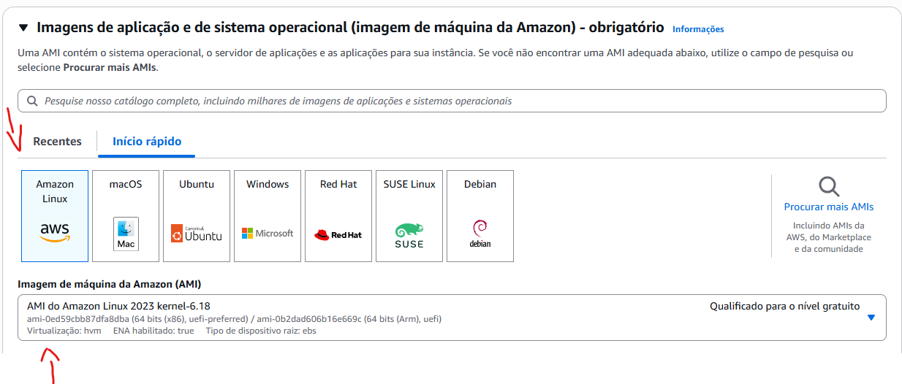

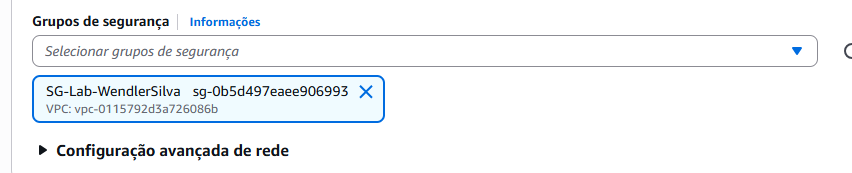

Também foi configurado o script de dados do usuário (*User Data*), responsável por instalar, iniciar e habilitar o Apache durante a inicialização da instância. O script também cria uma página web que exibe o hostname do servidor, facilitando a identificação de qual instância atende cada requisição.

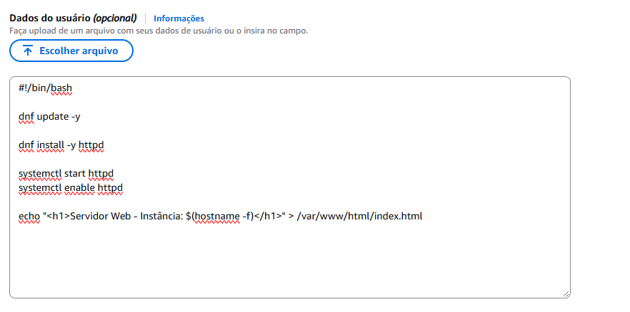

Após revisar as configurações, o Launch Template foi criado.

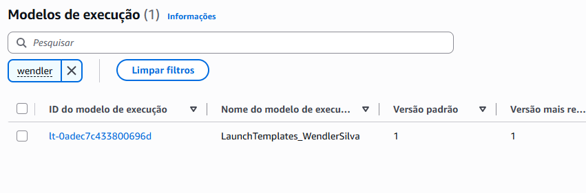

## 3. Criação do Auto Scaling Group

O Auto Scaling Group foi configurado para utilizar o Launch Template criado anteriormente. Foram selecionadas a VPC padrão e sub-redes públicas distribuídas em duas Zonas de Disponibilidade.

Essa configuração permite que as instâncias sejam distribuídas entre diferentes zonas, reduzindo a dependência de uma única Zona de Disponibilidade.

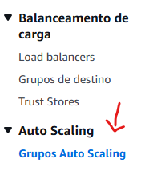

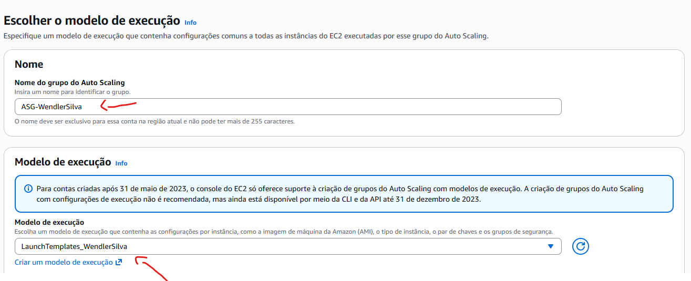

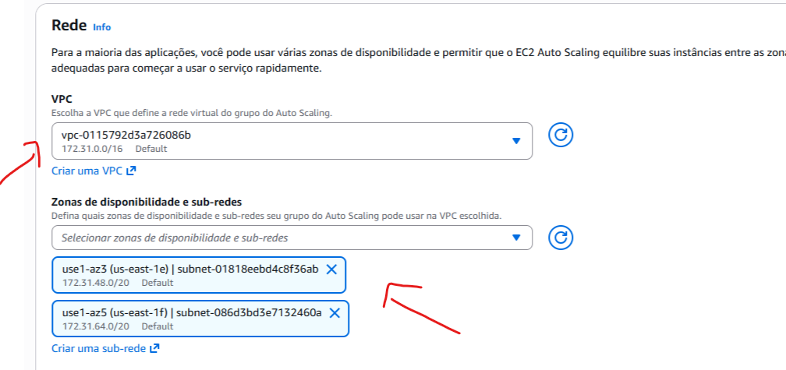

## 4. Integração com Application Load Balancer

Durante a configuração do Auto Scaling Group, foi criado um Application Load Balancer do tipo internet-facing, permitindo que a aplicação seja acessada pela internet.

Também foi criado um grupo de destino (*Target Group*) para encaminhar as requisições às instâncias EC2. O balanceador foi configurado com um listener HTTP na porta 80, e a verificação de integridade (*health check*) do Elastic Load Balancing foi habilitada para acompanhar a saúde dos destinos.

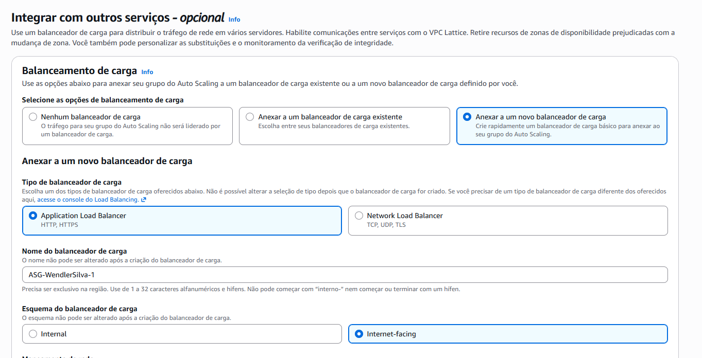

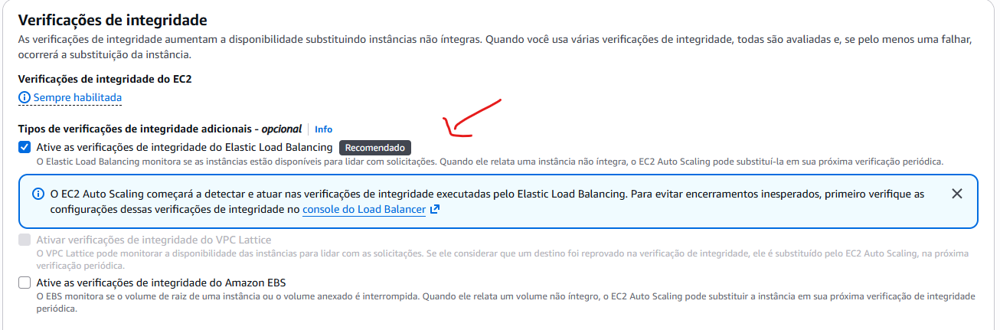

## 5. Configuração da capacidade e identificação das instâncias

Para este laboratório, foram definidas as seguintes capacidades do Auto Scaling Group:

- **Capacidade mínima:** 2 instâncias.
- **Capacidade desejada:** 2 instâncias.
- **Capacidade máxima:** 2 instâncias.

Esses valores mantêm duas instâncias como configuração fixa para o exercício. Embora o Auto Scaling Group gerencie o ciclo de vida das instâncias e possa substituir instâncias não saudáveis, a configuração não inclui uma política de escalabilidade dinâmica baseada na demanda.

Também foi adicionada uma etiqueta (*tag*) para facilitar a identificação dos recursos.

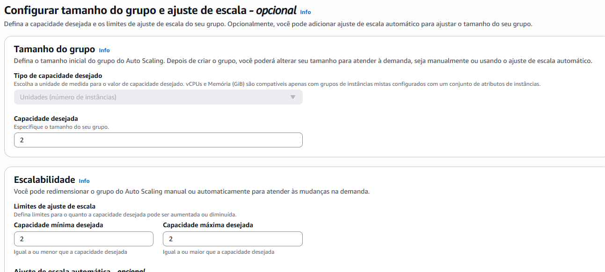

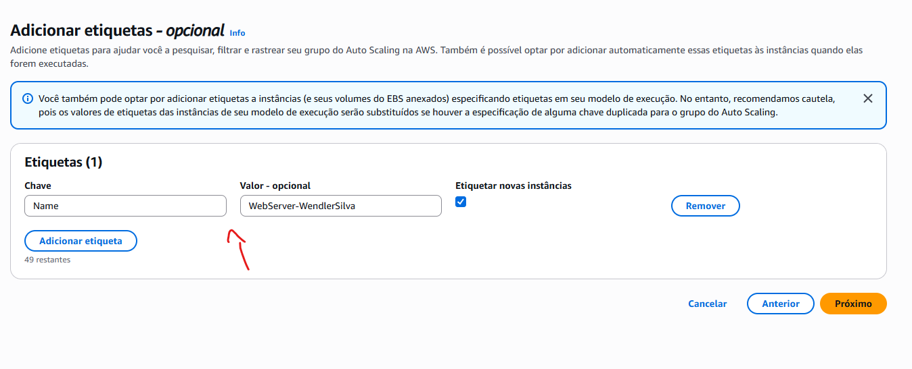

Após revisar as configurações, o Auto Scaling Group foi criado.

## 6. Validação da aplicação web

Com o ambiente criado, a aplicação foi acessada pelo endereço DNS do Application Load Balancer.

A página web exibe o hostname da instância EC2 que atende à requisição. Ao atualizar a página, é possível observar respostas provenientes das duas instâncias, demonstrando a distribuição do tráfego pelo balanceador de carga.

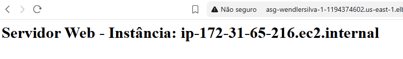

## 7. Resultado

O laboratório demonstrou a implementação de um ambiente web com maior disponibilidade e distribuição de tráfego na AWS.

Principais resultados:

- Criação de um Launch Template para padronizar a inicialização das instâncias.
- Configuração de um Auto Scaling Group com duas instâncias EC2 em diferentes Zonas de Disponibilidade.
- Integração do Auto Scaling Group com um Application Load Balancer.
- Configuração de um grupo de destino e verificações de integridade.
- Distribuição de requisições HTTP entre as instâncias.
- Validação da aplicação por meio do hostname exibido na página web.

## Serviços AWS utilizados

- Amazon EC2
- Amazon EC2 Launch Templates
- EC2 Auto Scaling
- Elastic Load Balancing — Application Load Balancer
- Amazon VPC
- Security Groups

## Conhecimentos praticados

- Alta disponibilidade na AWS.
- Distribuição de tráfego entre instâncias.
- Configuração de servidores web com User Data.
- Gerenciamento de capacidade com Auto Scaling Groups.
- Uso de verificações de integridade para monitoramento dos destinos.
- Distribuição de recursos entre Zonas de Disponibilidade.
