# ☁️ Amazon EC2, CloudWatch e SNS

## Objetivo

Neste laboratório, foi implementado um monitoramento básico de uma instância Amazon EC2 utilizando o Amazon CloudWatch e o Amazon SNS.

O objetivo foi acompanhar a utilização de CPU da instância, configurar um alarme para identificar uso elevado do processador e receber notificações por e-mail quando o limite estabelecido fosse ultrapassado.

Também foi gerada uma carga controlada de CPU para validar o funcionamento do alarme e das notificações.

## Arquitetura implementada

- **Amazon EC2:** instância utilizada para executar o servidor e gerar carga de CPU.
- **Amazon CloudWatch:** monitoramento das métricas e gerenciamento do alarme.
- **Amazon SNS:** envio de notificações por e-mail.
- **SSH:** acesso remoto à instância para instalação e execução da ferramenta de teste.
- **stress-ng:** ferramenta utilizada para gerar carga de CPU durante a validação.

## 1. Criação da instância EC2

Inicialmente, foi acessado o serviço Amazon EC2 para criar uma instância que seria utilizada nos testes de monitoramento.

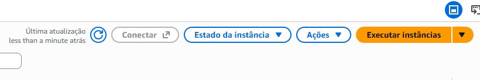

A instância foi configurada com um nome de identificação e a imagem Amazon Linux 2023, conforme os requisitos do laboratório.

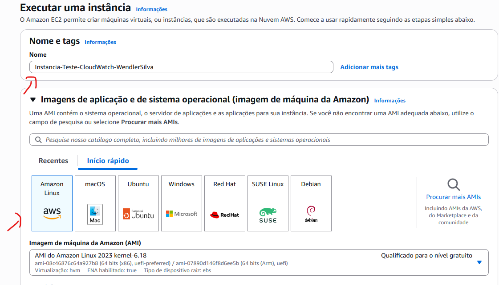

Foi selecionado o tipo de instância `t2.micro`, utilizado neste exercício para executar os testes de carga e monitoramento.

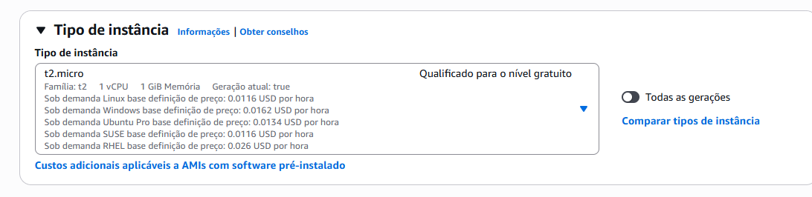

Também foi configurado um par de chaves (*Key Pair*) para permitir o acesso remoto à instância por SSH.

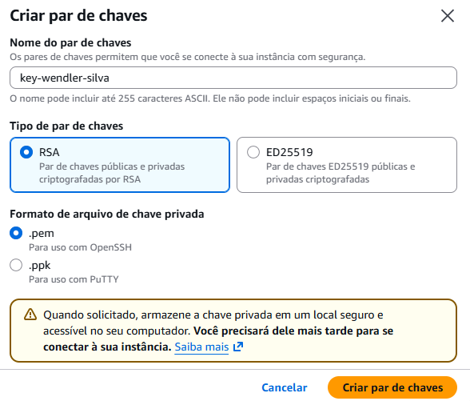

Nas configurações de rede, foi selecionada a VPC padrão e uma sub-rede pública, com atribuição de endereço IP público habilitada. Também foi criado um Security Group para controlar o acesso à instância.

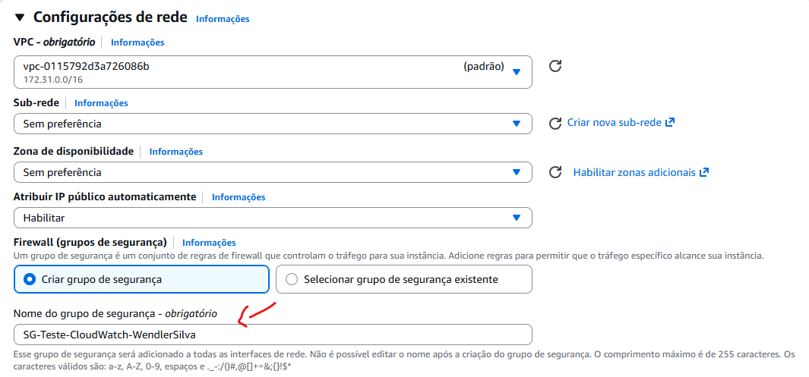

A regra de entrada do Security Group foi configurada para permitir SSH, restrito ao endereço IP de origem do usuário (*My IP*).

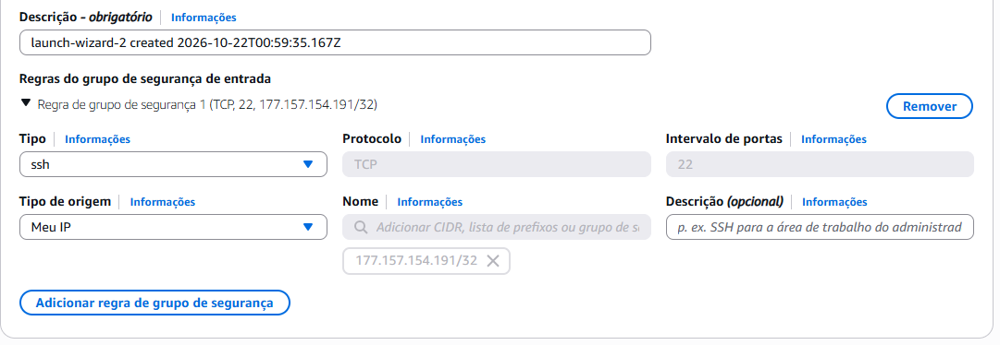

Após revisar as configurações, a instância foi iniciada.

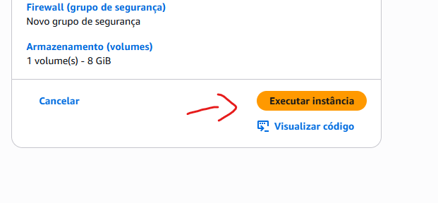

Com a instância em execução, foi anotado seu ID para utilizá-lo na seleção das métricas do CloudWatch. Foi aguardado o tempo necessário para que as métricas estivessem disponíveis.

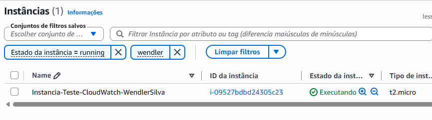

## 2. Configuração do alarme no CloudWatch

Com a instância criada, foi acessado o Amazon CloudWatch para configurar o monitoramento da utilização de CPU.

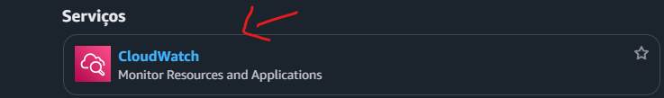

Na seção de alarmes, foi iniciada a criação de um novo alarme.

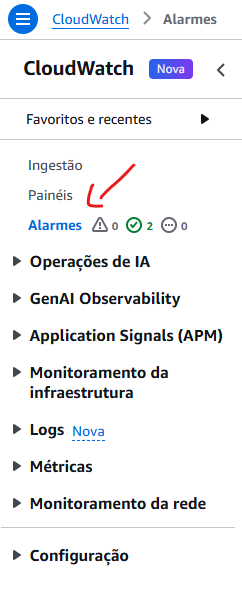

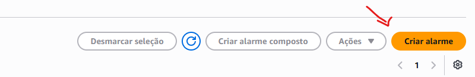

Na etapa de seleção de métricas, foi escolhida a categoria de métricas do Amazon EC2 por instância (*Per-Instance Metrics*).

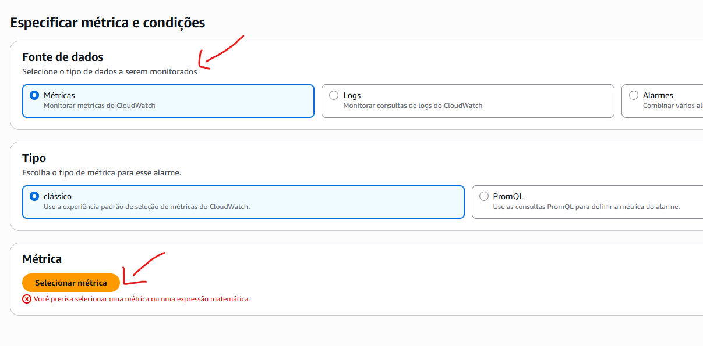

O ID da instância EC2 foi utilizado para localizar as métricas correspondentes ao recurso criado.

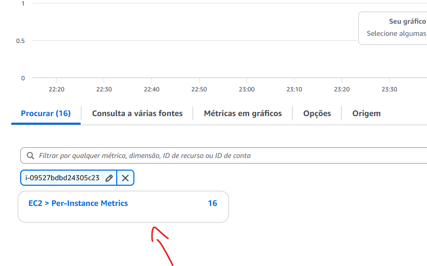

Em seguida, foi selecionada a métrica `CPUUtilization`, responsável por representar a porcentagem de utilização da CPU da instância.

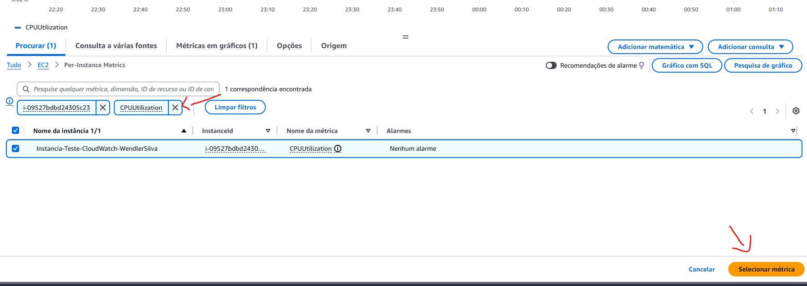

O alarme foi configurado utilizando a estatística **Average**, com período de avaliação de cinco minutos.

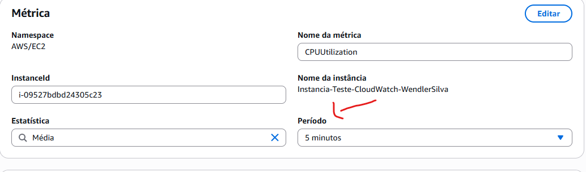

Como condição, foi definido o disparo do alarme quando a utilização média da CPU fosse superior a 70%.

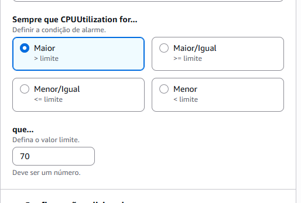

## 3. Configuração das notificações com Amazon SNS

Para receber notificações quando o alarme entrasse no estado de alerta, foi criado um tópico do Amazon SNS.

O tópico foi associado a um endereço de e-mail, cuja assinatura precisou ser confirmada para que as notificações pudessem ser recebidas.

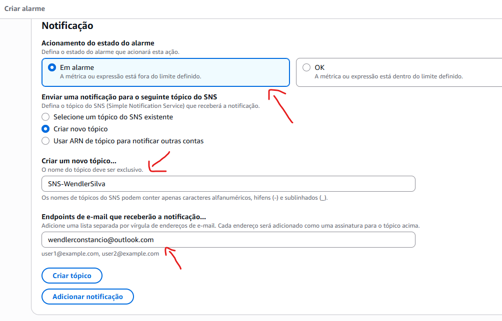

Após configurar as ações de notificação, foi definido um nome para identificar o alarme no CloudWatch.

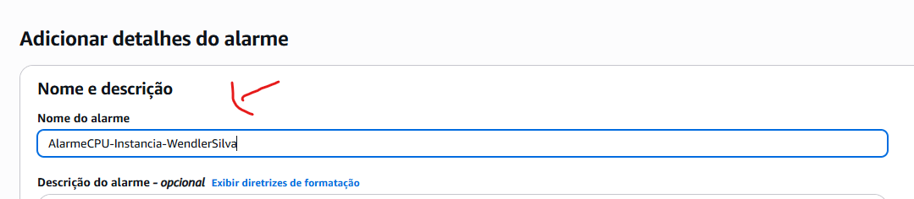

O alarme foi configurado para enviar notificações quando a condição de CPU definida fosse atingida.

## 4. Acesso remoto à instância EC2

Para gerar carga de processamento e testar o alarme, foi realizado o acesso remoto à instância EC2 por SSH, utilizando o ambiente Windows.

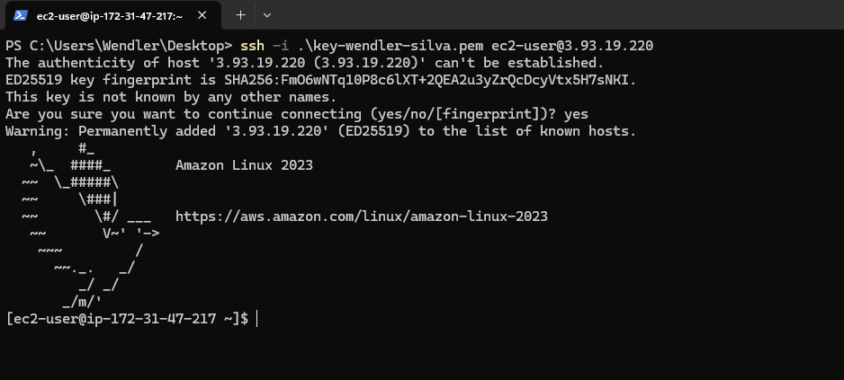

Após estabelecer a conexão, o sistema foi atualizado e a ferramenta `stress-ng` foi instalada. Essa ferramenta permite gerar carga de CPU de forma controlada para validar o comportamento do monitoramento.

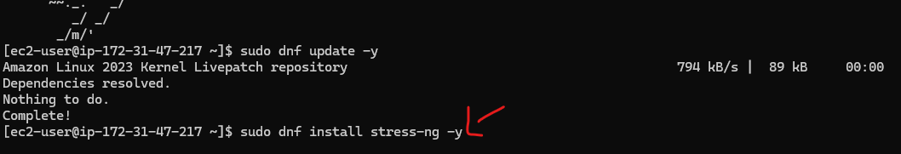

Em seguida, foi executado o teste de carga de CPU. A ferramenta foi configurada para gerar processamento durante um período limitado, permitindo observar o aumento da métrica `CPUUtilization`.

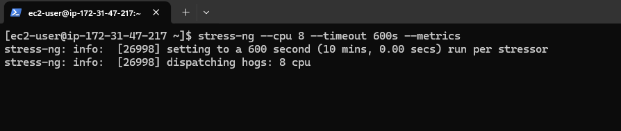

## 5. Validação do alarme e das notificações

Com a carga de CPU em execução, foi acessado o CloudWatch para verificar o estado do alarme.

Após o período de avaliação, a utilização da CPU ultrapassou o limite configurado e o alarme entrou no estado **In alarm**.

Também foi verificado o recebimento da notificação enviada pelo Amazon SNS por e-mail, confirmando a integração entre o CloudWatch e o serviço de notificações.

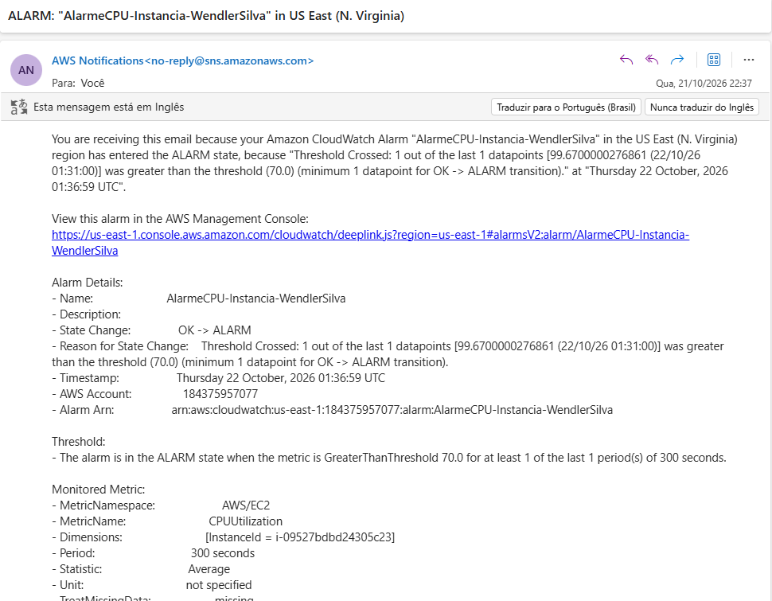

Após a validação, o teste de carga foi interrompido para encerrar a geração artificial de processamento.

## 6. Resultado

O laboratório permitiu praticar os fundamentos de monitoramento e observabilidade de recursos na AWS.

Principais resultados:

- Criação e configuração de uma instância Amazon EC2.
- Configuração de acesso SSH com regra de segurança restrita ao IP de origem.
- Seleção da métrica `CPUUtilization` no Amazon CloudWatch.
- Criação de um alarme com limite de utilização de CPU superior a 70%.
- Integração do CloudWatch com um tópico do Amazon SNS.
- Configuração de notificações por e-mail.
- Geração de carga controlada com `stress-ng`.
- Validação do alarme e do recebimento das notificações.

## Serviços e ferramentas utilizados

- Amazon EC2
- Amazon CloudWatch
- Amazon SNS
- Security Groups
- SSH
- Amazon Linux 2023
- stress-ng

## Conhecimentos praticados

- Monitoramento de métricas de infraestrutura.
- Configuração de alarmes no CloudWatch.
- Notificações automatizadas com Amazon SNS.
- Acesso remoto seguro a instâncias EC2.
- Testes controlados de carga de CPU.
- Observabilidade básica de recursos em nuvem.
