# 🚀 Integração Amazon S3, SNS e SQS

## Objetivo

Neste laboratório, foi implementada uma arquitetura orientada a eventos na AWS utilizando Amazon S3, Amazon SNS e Amazon SQS.

O objetivo foi configurar notificações automáticas para eventos de criação e exclusão de objetos em um bucket S3, distribuindo as mensagens para dois destinos: uma notificação por e-mail e uma fila SQS para consulta e processamento posterior.

## Arquitetura implementada

- **Amazon S3:** armazenamento de objetos e origem dos eventos.
- **Amazon SNS:** distribuição das notificações para múltiplos assinantes.
- **Amazon SQS:** armazenamento das mensagens para consulta e processamento posterior.
- **E-mail:** recebimento de notificações sobre as operações realizadas no bucket.
- **Políticas de acesso:** controle das permissões entre os serviços AWS.

A arquitetura utiliza o padrão *fan-out*, no qual uma única mensagem publicada no SNS pode ser distribuída simultaneamente para diferentes destinos.

## 1. Criação do bucket Amazon S3

O bucket S3 é o ponto inicial da arquitetura. Nele são armazenados os arquivos, e suas operações de criação e exclusão geram os eventos que serão encaminhados para os demais serviços.

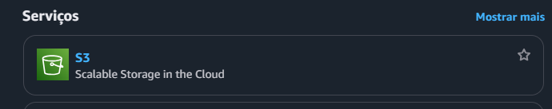

Foi iniciada a criação de um novo bucket no console do Amazon S3.

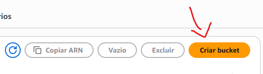

Em seguida, foi definido o nome do bucket, respeitando as regras de nomenclatura do serviço e utilizando a região AWS prevista para o laboratório.

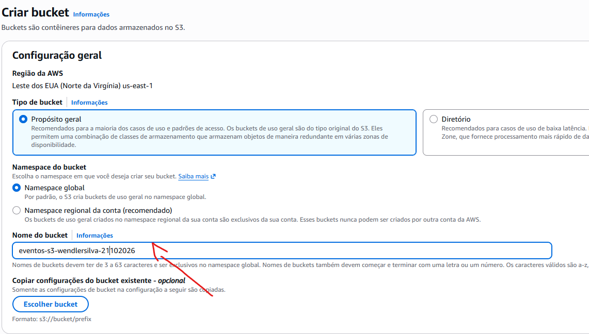

## 2. Criação do tópico Amazon SNS

O Amazon SNS será responsável por receber as notificações de eventos do S3 e distribuí-las aos assinantes configurados.

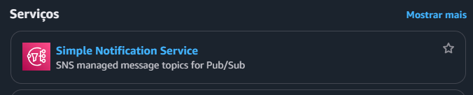

Na seção de tópicos, foi iniciada a criação de um novo tópico SNS.

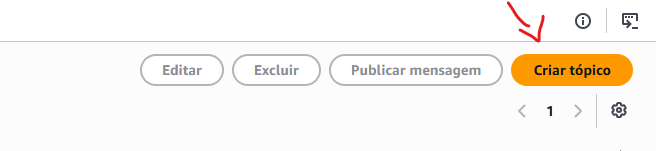

O tópico foi configurado como **Padrão**, com um nome que permite identificá-lo como parte da arquitetura de notificações do S3.

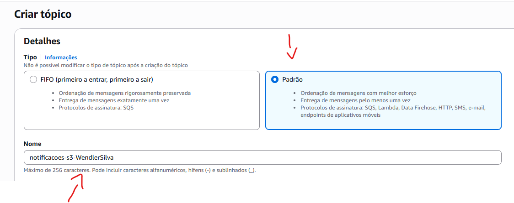

## 3. Configuração da assinatura de e-mail

Para receber as notificações diretamente por e-mail, foi adicionada uma assinatura ao tópico SNS.

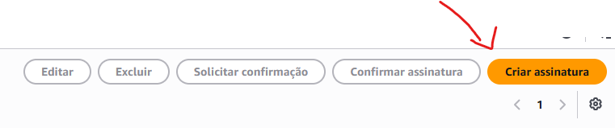

O protocolo **E-mail** foi selecionado, e o endereço de destino foi informado para receber as mensagens publicadas no tópico.

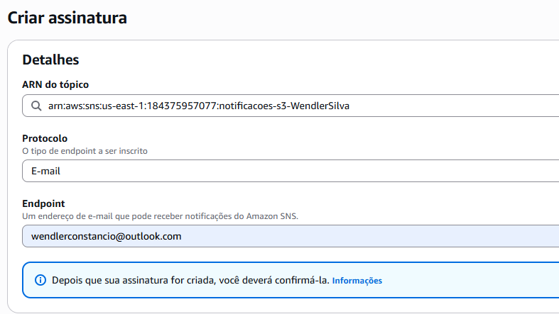

Após revisar os dados, a assinatura foi criada.

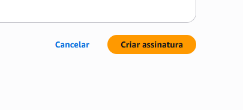

A inscrição precisou ser confirmada por meio do link enviado pela AWS. Essa confirmação é necessária para que o endereço receba as notificações do tópico.

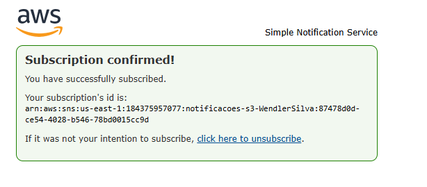

## 4. Criação da fila Amazon SQS

O Amazon SQS será utilizado como segundo destino das notificações. Diferentemente do e-mail, a fila mantém as mensagens disponíveis para consulta e processamento posterior.

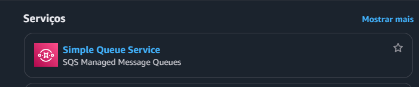

Foi iniciada a criação de uma nova fila no console do Amazon SQS.

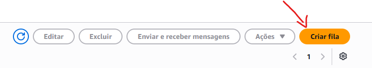

A fila foi configurada como **Padrão** e recebeu um nome de identificação para o laboratório.

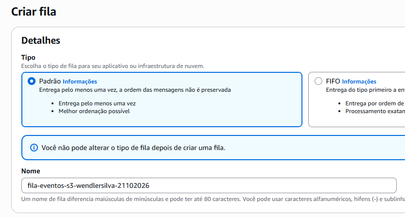

Após a criação, o ARN da fila foi utilizado nas etapas de configuração das permissões e da assinatura do SNS.

## 5. Configuração da política de acesso do SNS

Para permitir que o Amazon S3 publique eventos no tópico SNS, foi necessário ajustar a política de acesso do tópico.

A política foi configurada para autorizar o serviço S3 a executar a ação `SNS:Publish`, restringindo a origem ao bucket criado para o laboratório. Essa restrição ajuda a evitar publicações originadas de recursos não autorizados.

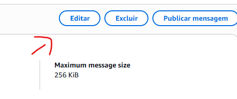

A política de acesso foi editada com os valores correspondentes aos recursos criados, incluindo o ARN do tópico, o ARN do bucket e o ID da conta AWS onde exigido pela política utilizada.

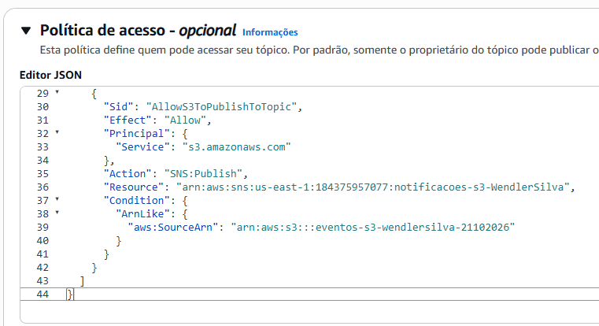

## 6. Configuração da política de acesso da fila SQS

Também foi necessário configurar a política de acesso da fila SQS para permitir que o tópico SNS encaminhasse mensagens para ela.

A permissão `sqs:SendMessage` foi concedida ao serviço SNS, restringindo a origem ao ARN do tópico específico. Dessa forma, a fila pode receber as mensagens do tópico autorizado.

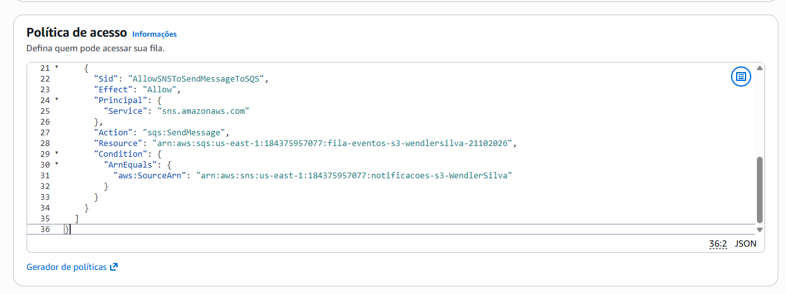

## 7. Criação da assinatura SQS no tópico SNS

Com as permissões configuradas, foi acessado novamente o Amazon SNS para adicionar a fila SQS como assinante do tópico.

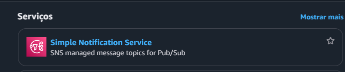

Na seção de assinaturas, foi iniciada a criação de uma nova assinatura para integrar o SNS à fila SQS.

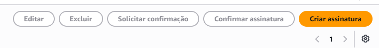

O protocolo **Amazon SQS** foi selecionado, e o ARN da fila criada anteriormente foi informado como destino. A opção de entrega de mensagem bruta (*Raw Message Delivery*) foi habilitada para que a fila recebesse o conteúdo da mensagem sem o envelope adicional do SNS.

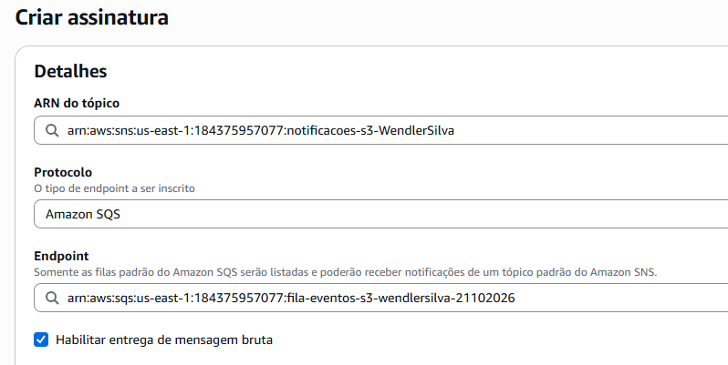

Com essa configuração, o tópico SNS passa a ter dois destinos: o e-mail e a fila SQS. Uma mesma notificação pode ser encaminhada aos dois assinantes.

## 8. Configuração das notificações de eventos no S3

Depois de criar os recursos e configurar as permissões, foi necessário definir quais eventos do bucket seriam publicados no tópico SNS.

Na página de propriedades do bucket, foi acessada a seção de notificações de eventos.

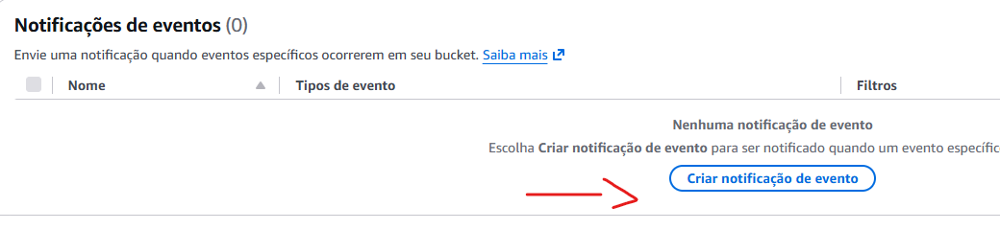

Foi criada uma notificação com o nome `NotificarPutDelete`, utilizada para identificar a configuração responsável por acompanhar as operações de criação e exclusão de objetos.

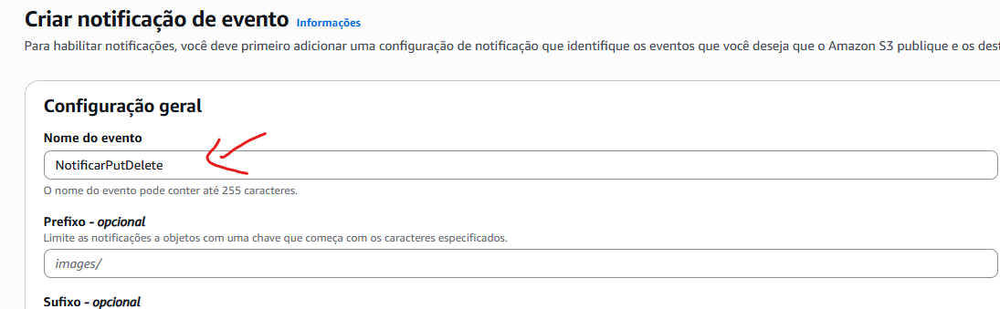

Foram selecionados os eventos de criação de objetos (`s3:ObjectCreated:*`) e de remoção de objetos (`s3:ObjectRemoved:*`).

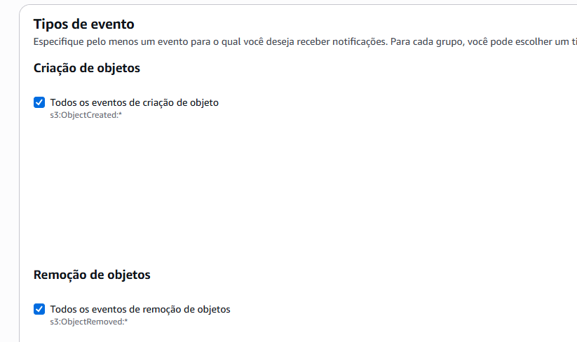

Como destino das notificações, foi selecionado o tópico SNS criado anteriormente.

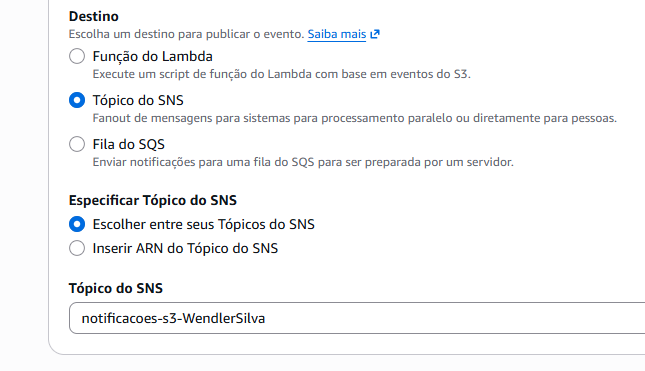

Após salvar a configuração, o bucket passou a estar configurado para publicar notificações dos tipos de evento selecionados.

## 9. Teste da arquitetura

Para validar o funcionamento da integração, foi realizado o upload de um novo arquivo para o bucket S3. Essa operação gera um evento de criação de objeto, que deve ser encaminhado ao tópico SNS.

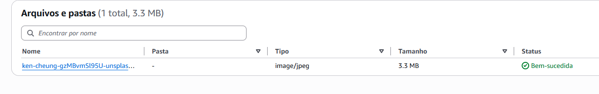

Após o upload, foi verificado o recebimento da notificação por e-mail.

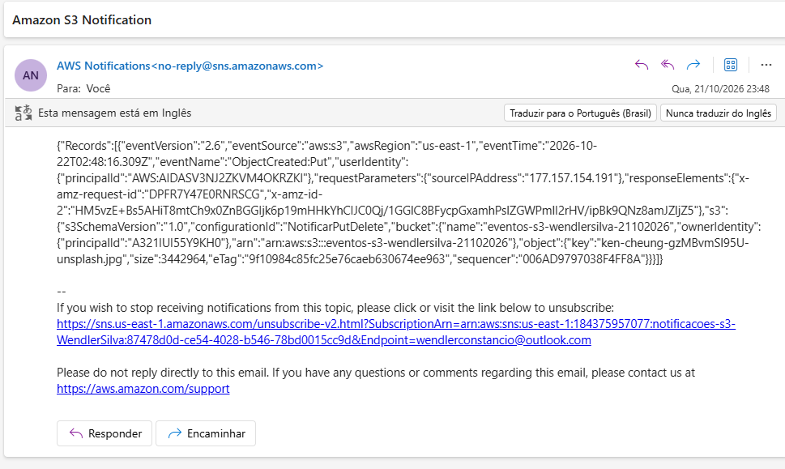

A validação completa da arquitetura também inclui consultar a fila SQS e verificar a mensagem correspondente ao evento. O teste de exclusão deve ser realizado separadamente para confirmar o funcionamento da notificação de remoção.

## 10. Resultado

O laboratório demonstrou como integrar serviços gerenciados da AWS para construir uma arquitetura orientada a eventos.

Principais resultados:

- Criação de um bucket Amazon S3.
- Configuração de um tópico Amazon SNS.
- Criação e confirmação de uma assinatura de e-mail.
- Criação de uma fila Amazon SQS.
- Configuração de políticas de acesso entre S3, SNS e SQS.
- Integração do bucket S3 com o tópico SNS por meio de notificações de eventos.
- Configuração de dois destinos para as mensagens: e-mail e fila SQS.
- Teste inicial da arquitetura por meio do upload de um objeto.

## Serviços AWS utilizados

- Amazon S3
- Amazon SNS
- Amazon SQS
- AWS IAM — políticas de acesso baseadas em recursos

## Conhecimentos praticados

- Arquitetura orientada a eventos.
- Integração entre serviços gerenciados da AWS.
- Distribuição de mensagens com o padrão *fan-out*.
- Notificações automáticas de eventos do S3.
- Assinaturas de tópicos SNS por e-mail e SQS.
- Controle de permissões entre serviços AWS.
- Validação de eventos e mensagens em uma arquitetura distribuída.
