# 🚀 Laboratório 07 — AWS Serverless Memory Game

## 📌 Sobre o Laboratório

Neste laboratório, foi desenvolvido e integrado um jogo da memória a uma arquitetura Serverless na AWS. A aplicação utiliza serviços gerenciados para hospedar o site, processar os resultados dos jogadores e armazenar as informações das partidas.

A solução utiliza Amazon S3 para hospedagem do site estático, Amazon DynamoDB para armazenamento dos resultados, AWS Lambda para processamento da lógica de negócio e Amazon API Gateway para disponibilizar os endpoints de comunicação entre o frontend e o backend.

## 🎯 Objetivos

- Hospedar uma aplicação web estática utilizando Amazon S3.
- Configurar hospedagem de site estático e acesso público ao conteúdo.
- Criar uma tabela no Amazon DynamoDB para armazenar os resultados.
- Criar uma IAM Role com permissões específicas para a função Lambda.
- Desenvolver uma função AWS Lambda utilizando Python 3.12.
- Criar uma API REST no Amazon API Gateway.
- Integrar o frontend com os serviços backend.
- Testar o funcionamento da aplicação e validar o armazenamento dos resultados.

## 🛠️ Serviços AWS utilizados

- **Amazon S3:** hospedagem do site estático.
- **Amazon DynamoDB:** armazenamento dos resultados das partidas.
- **AWS IAM:** gerenciamento de funções e permissões.
- **AWS Lambda:** execução da lógica de processamento.
- **Amazon API Gateway:** criação dos endpoints REST.
- **Amazon CloudWatch:** registro de logs da função Lambda.

---

## 1. Criação do bucket S3

O primeiro passo foi criar um bucket no Amazon S3 para armazenar os arquivos da aplicação, incluindo a página HTML, arquivos CSS, JavaScript e os recursos visuais do jogo.

Durante a criação, foi necessário desabilitar o bloqueio de acesso público para permitir que o site pudesse ser acessado pelo endpoint de hospedagem estática.

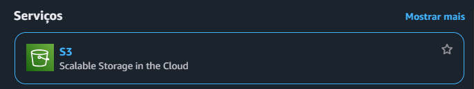

Após acessar o serviço, foi iniciado o processo de criação de um novo bucket.

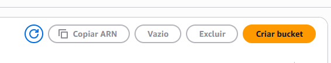

Foi definido um nome exclusivo para o bucket, conforme as regras de nomenclatura do Amazon S3.

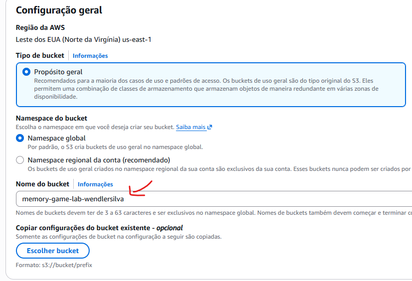

Para permitir a hospedagem pública do site, foi desmarcada a opção de bloqueio de todo o acesso público.

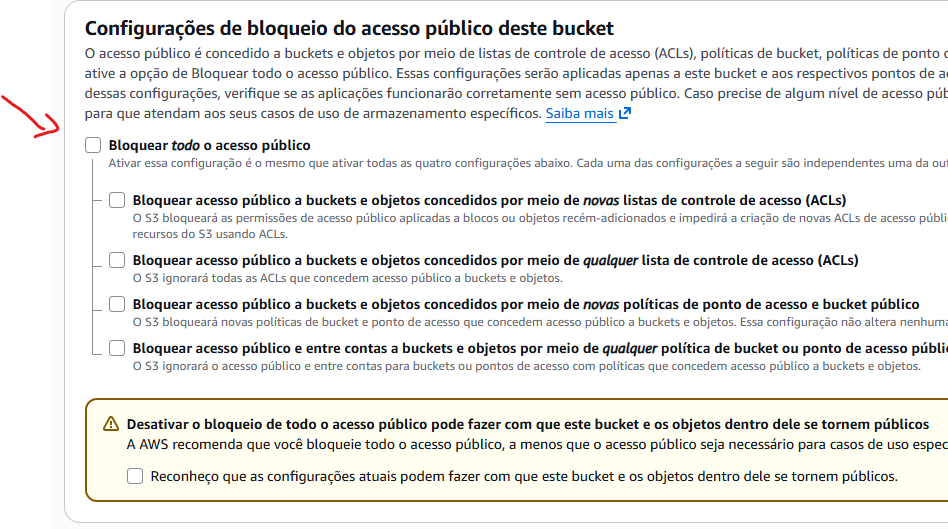

Com as configurações definidas, o bucket foi criado.

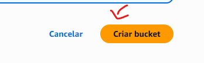

## 2. Upload dos arquivos da aplicação

Com o bucket disponível, foram enviados os arquivos necessários para executar o jogo da memória. A estrutura inclui a página principal, arquivos de estilo, scripts JavaScript e recursos utilizados pela aplicação.

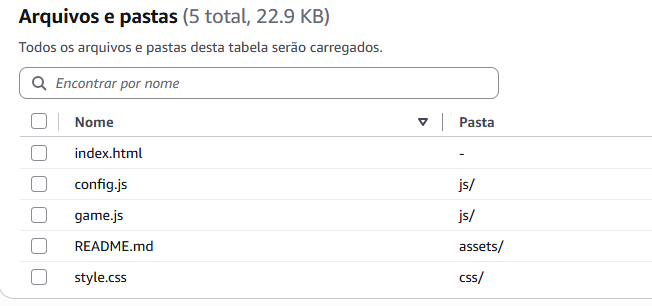

## 3. Configuração da hospedagem de site estático

Na aba de propriedades do bucket, foi localizada a configuração de hospedagem de site estático.

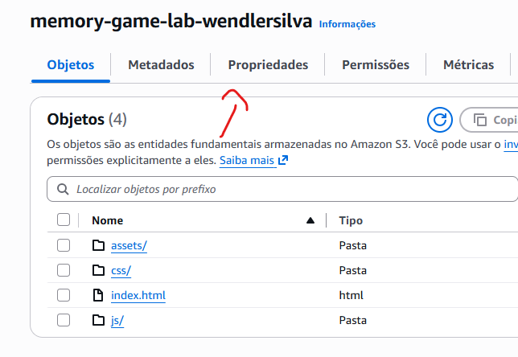

A hospedagem foi ativada e o documento de índice foi definido como `index.html`, indicando a página que será carregada quando o usuário acessar o site.

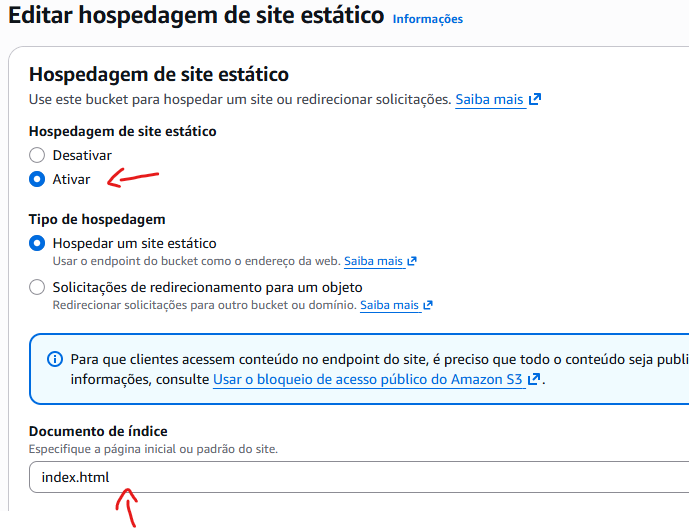

Em seguida, foram revisadas as configurações da hospedagem estática.

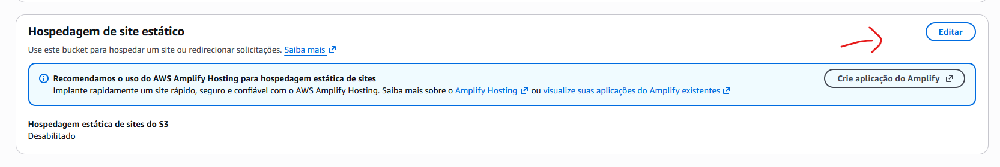

## 4. Configuração da política de acesso do bucket

Após ativar a hospedagem, foi necessário configurar as permissões para permitir a leitura pública dos arquivos da aplicação.

A configuração foi realizada na aba de permissões do bucket.

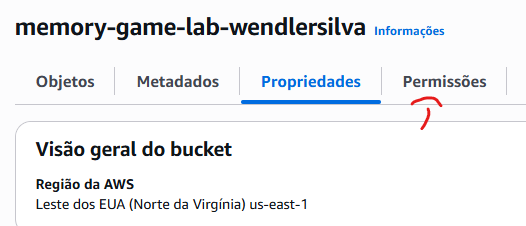

Na seção de política do bucket, foi aberta a opção de edição para adicionar a política de acesso.

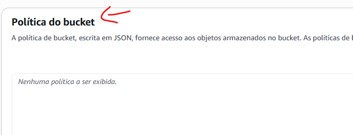

Para gerar a política, foi utilizado um gerador de políticas AWS.

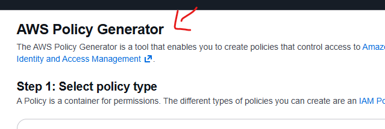

No gerador, foram definidos os parâmetros necessários para permitir a leitura dos objetos armazenados no bucket.

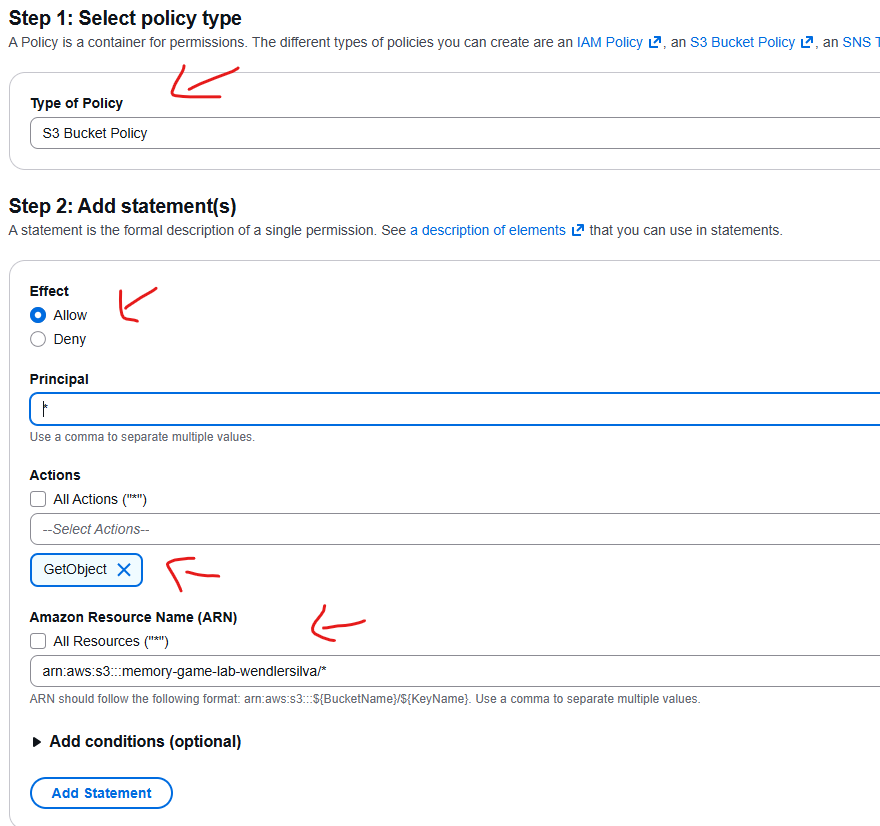

Após preencher as informações, a política foi gerada.

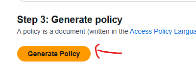

O conteúdo gerado foi copiado para ser utilizado nas permissões do bucket.

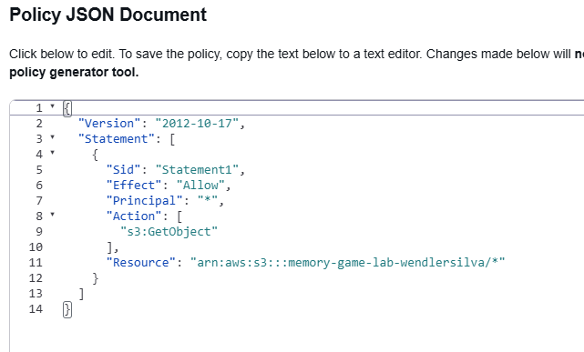

A política foi colada no campo correspondente dentro do console do Amazon S3 e salva.

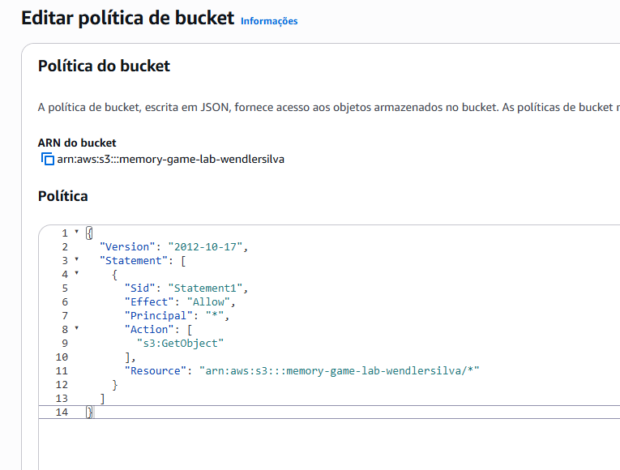

Com as permissões configuradas, foi realizado um teste de acesso ao site. A página do jogo passou a carregar corretamente pelo endpoint de hospedagem estática.

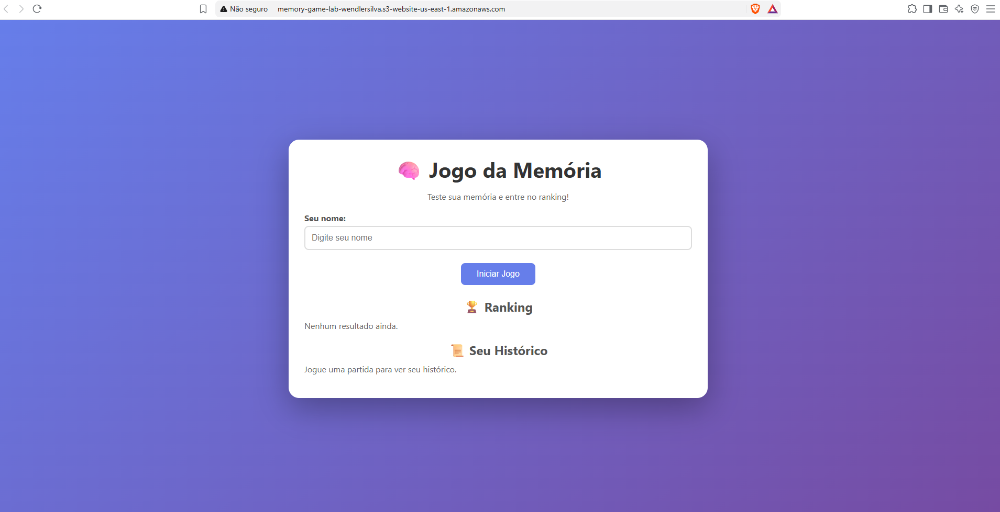

## 5. Criação da tabela no Amazon DynamoDB

Com o frontend hospedado, o próximo passo foi configurar o armazenamento dos resultados das partidas.

Foi acessado o Amazon DynamoDB para criar uma tabela que receberá os dados dos jogadores.

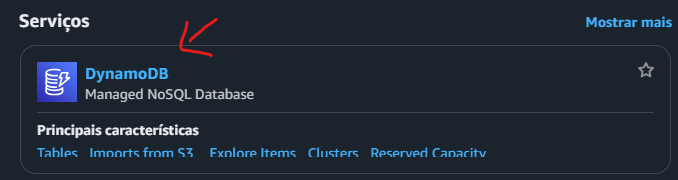

Na página do serviço, foi iniciado o processo de criação de uma nova tabela.

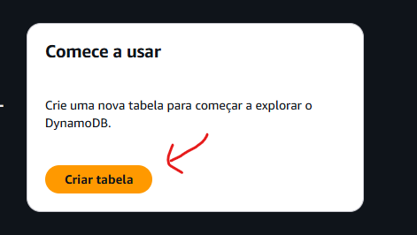

A tabela foi configurada com uma chave de partição `playerId` e uma chave de classificação `gameId`, permitindo organizar os registros dos jogadores e suas partidas.

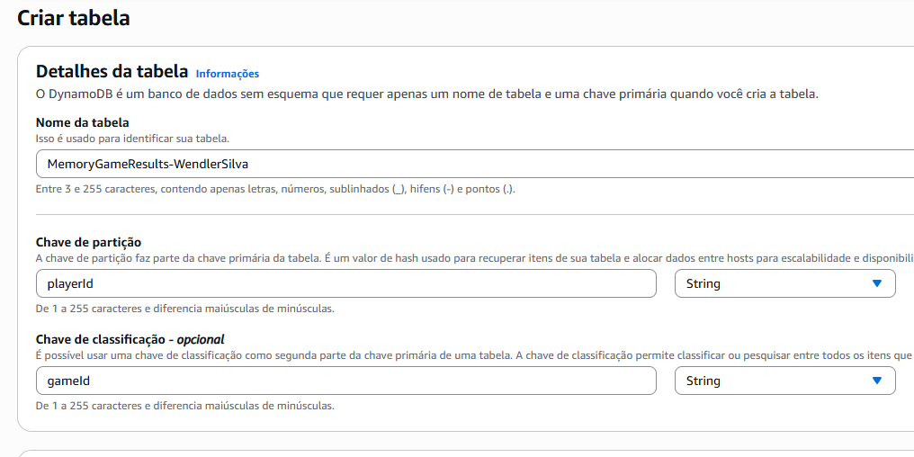

Após definir as configurações, a tabela foi criada.

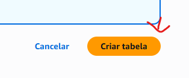

## 6. Criação da IAM Role para o AWS Lambda

Para que a função Lambda pudesse acessar o DynamoDB e registrar logs no CloudWatch, foi criada uma função do IAM com as permissões necessárias.

Primeiramente, foi acessado o serviço AWS IAM.

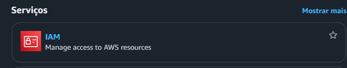

Na área de gerenciamento de funções, foi iniciada a criação de uma nova Role.

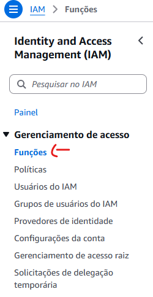

Foi selecionada a opção para criar uma nova função.

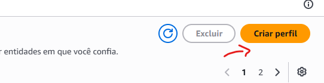

Como entidade confiável, foi selecionado um serviço da AWS, utilizando o Lambda como caso de uso.

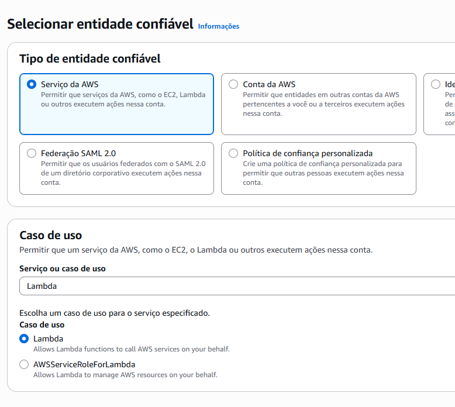

Foi adicionada a política `AWSLambdaBasicExecutionRole`, necessária para permitir que a função registre logs no CloudWatch.

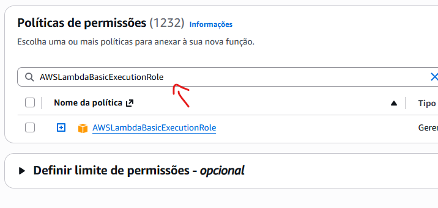

Em seguida, foi definido o nome da Role.

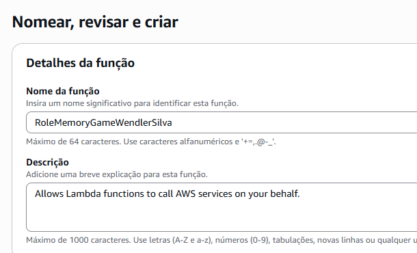

Com as configurações preenchidas, a Role foi criada.

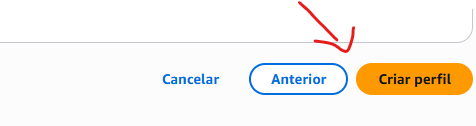

Após a criação, a função foi localizada e aberta para configurar permissões adicionais.

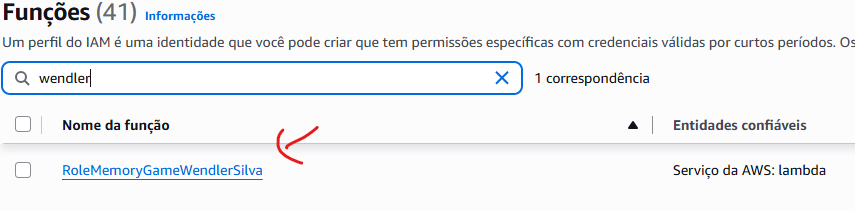

Foi adicionada uma política em linha para conceder acesso às operações necessárias do DynamoDB.

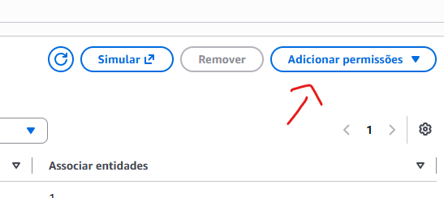

O documento da política foi inserido com as permissões necessárias para a tabela utilizada pela aplicação.

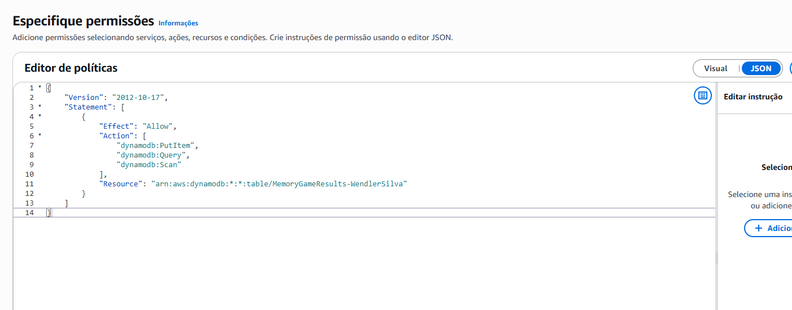

Por fim, a política recebeu um nome e foi criada.

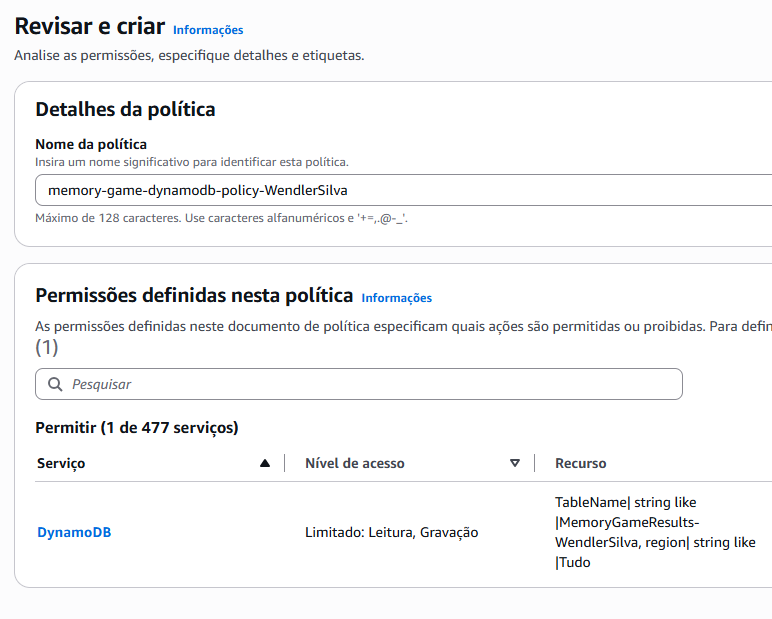

## 7. Criação da função AWS Lambda

Com a tabela e as permissões configuradas, foi criada a função Lambda responsável por processar as operações da aplicação.

O serviço AWS Lambda foi acessado pelo console.

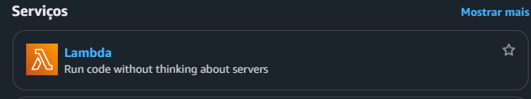

Foi iniciado o processo de criação de uma nova função.

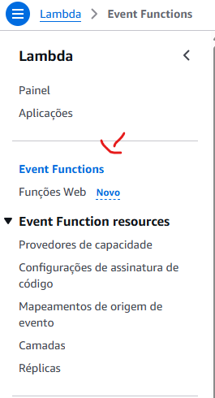

A opção de criação da função foi selecionada.

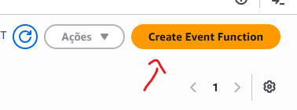

A função foi configurada do zero, utilizando Python 3.12 como ambiente de execução.

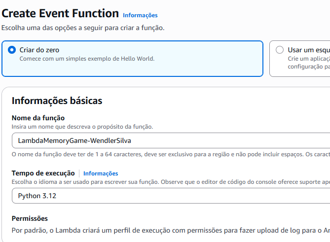

Nas configurações adicionais, foi selecionada a opção para personalizar a função de execução.

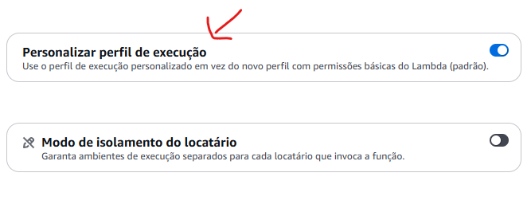

Foi escolhida a Role criada anteriormente, contendo as permissões necessárias para acessar o DynamoDB e registrar logs.

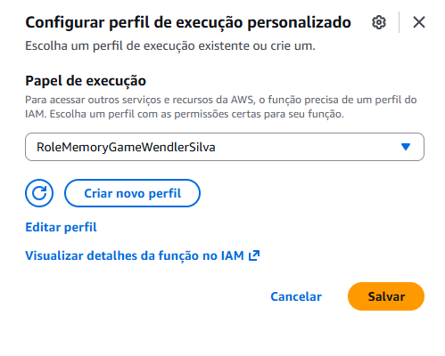

Após revisar as configurações, a função Lambda foi criada.

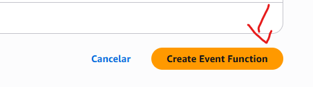

## 8. Configuração e teste da função Lambda

Com a função criada, foi inserido o código responsável por processar os resultados das partidas, consultar o ranking e recuperar o histórico de um jogador.

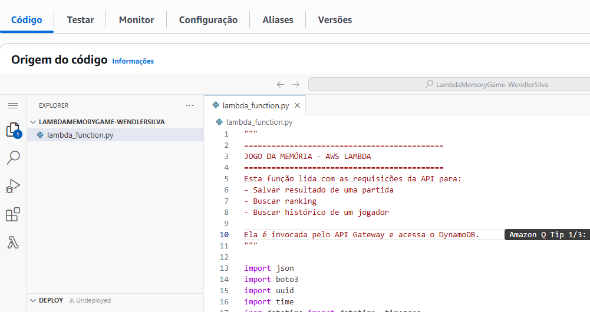

Após inserir o código, foi realizado o deploy para aplicar as alterações.

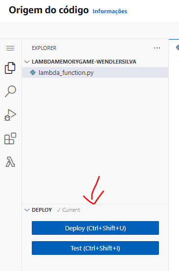

Na aba de testes, foi configurado um evento para validar o funcionamento da função.

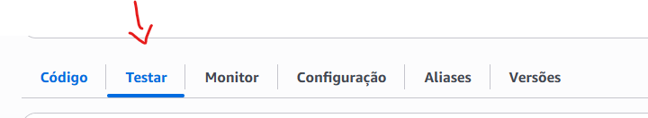

Foi criado um novo evento de teste com o JSON correspondente à operação de envio de resultado.

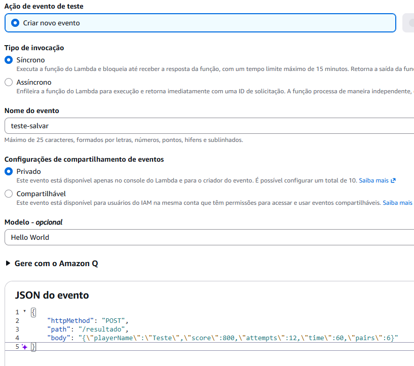

A execução foi realizada e o retorno confirmou o funcionamento esperado da função Lambda.

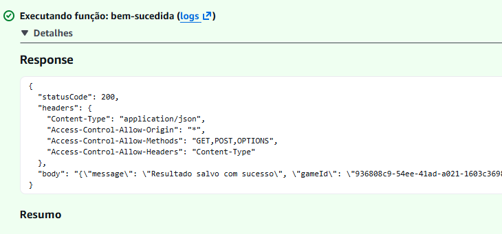

## 9. Criação da API REST no Amazon API Gateway

Para permitir a comunicação entre o jogo hospedado no S3 e a função Lambda, foi criada uma API REST utilizando o Amazon API Gateway.

O serviço foi acessado pelo console da AWS.

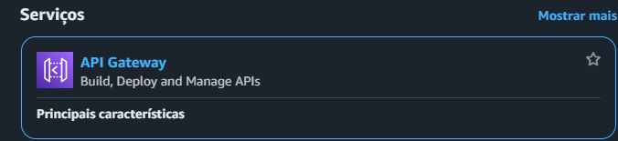

Foi iniciado o processo de criação de uma nova API.

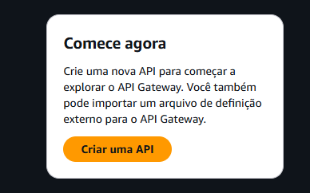

Foi selecionado o tipo REST API, com endpoint Regional, e definido um nome para a API.

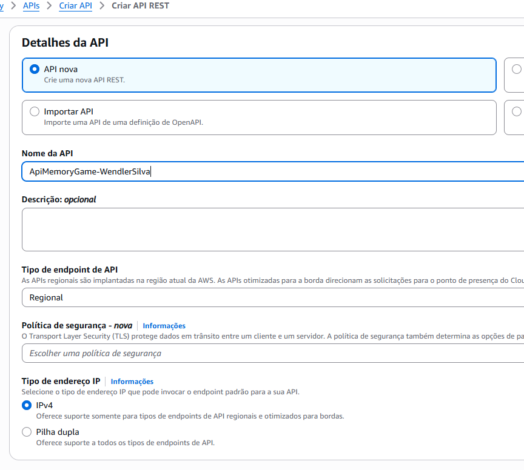

## 10. Criação dos recursos e métodos da API

Dentro da API, foram criados os recursos que representam os caminhos utilizados pela aplicação.

O primeiro recurso foi criado para a rota `/resultado`.

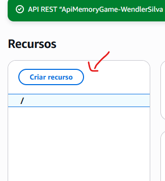

Foi definido o nome do recurso e confirmada sua criação.

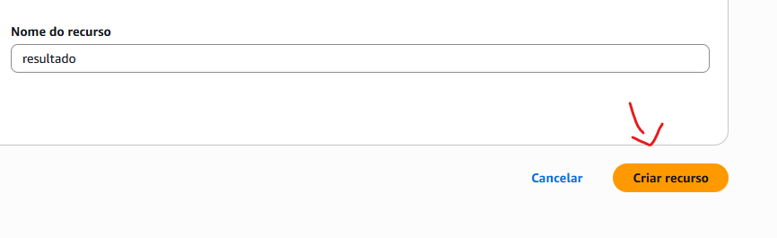

Com o recurso selecionado, foi iniciado o processo de criação de um método.

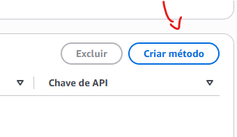

O método foi configurado para utilizar a função Lambda como integração, habilitando a integração de proxy.

Em seguida, foi criada a estrutura para a rota `/ranking`.

O recurso foi selecionado e o método correspondente foi configurado.

A integração com a função Lambda foi configurada utilizando o recurso de integração proxy.

Também foi criado o recurso para consultar o histórico de um jogador.

Foi configurada a estrutura do recurso para receber o nome do jogador como parâmetro.

O método GET foi associado à função Lambda por meio da integração de proxy.

## 11. Configuração do CORS e implantação da API

Para permitir que o frontend hospedado no Amazon S3 pudesse realizar chamadas à API, foi habilitado o CORS nos recursos criados.

Após configurar os recursos e métodos, a API foi implantada.

Foi criado o estágio `prod`, disponibilizando a URL de invocação da API.

## 12. Integração do frontend com a API

Com a API implantada, a URL de invocação foi configurada no arquivo `config.js` da aplicação, desabilitando o modo local para utilizar os serviços AWS.

O arquivo atualizado foi enviado novamente ao bucket S3 para que o site passasse a utilizar o backend serverless.

## 13. Teste final da aplicação

Após concluir as configurações, foi realizado um teste completo do jogo da memória, incluindo a finalização de uma partida e o envio do resultado para a API.

Por fim, foi verificado no Amazon DynamoDB que os resultados da partida foram armazenados corretamente.

---

## 📚 Aprendizados

Neste laboratório, foi possível praticar a integração de diferentes serviços AWS em uma arquitetura Serverless, compreendendo como uma aplicação web pode utilizar serviços gerenciados sem precisar manter servidores tradicionais.

Principais conhecimentos praticados:

- Hospedagem de aplicações estáticas com Amazon S3.
- Configuração de permissões e políticas de acesso.
- Modelagem e armazenamento de dados no Amazon DynamoDB.
- Criação de IAM Roles e políticas com permissões específicas.
- Desenvolvimento e testes de funções AWS Lambda com Python.
- Criação de APIs REST com Amazon API Gateway.
- Integração entre frontend, API e serviços backend.
- Validação do armazenamento de dados no DynamoDB.

## 🔐 Segurança

A hospedagem estática deste laboratório utiliza acesso público ao conteúdo do bucket S3. Essa configuração foi realizada para permitir o acesso ao jogo pelo navegador.

Em ambientes reais, é importante avaliar cuidadosamente as permissões públicas, conceder somente os acessos necessários e nunca armazenar credenciais, senhas ou informações sensíveis nos arquivos públicos da aplicação.