# 🚀 Laboratório AWS — Arquitetura de Três Camadas (Dia 1)

## 📌 Visão geral

Neste primeiro dia do laboratório, foi iniciada a construção de uma arquitetura web de três camadas na AWS, utilizando serviços de computação, mensageria e banco de dados.

A arquitetura utiliza instâncias Amazon EC2 para hospedar as aplicações de frontend e backend, um Application Load Balancer (ALB) para distribuir as requisições dos usuários, Amazon SQS para desacoplar o processamento das mensagens e Amazon DynamoDB para armazenar os registros processados.

O objetivo é construir uma estrutura organizada, resiliente e com comunicação controlada entre seus componentes.

## 🎯 Objetivos do Dia 1

- Criar uma tabela no Amazon DynamoDB.
- Criar uma fila no Amazon SQS.
- Configurar grupos de segurança para o Load Balancer e as instâncias EC2.
- Criar uma IAM Role para permitir que as instâncias acessem o SQS e o DynamoDB.
- Criar duas instâncias EC2 para o frontend.
- Configurar um Target Group e um Application Load Balancer.
- Criar duas instâncias EC2 para o backend.

## 🧰 Serviços AWS utilizados

- **Amazon DynamoDB:** armazenamento dos registros processados.
- **Amazon SQS:** fila responsável por receber as solicitações enviadas pelo frontend.
- **Amazon EC2:** execução das aplicações de frontend e backend.
- **Elastic Load Balancing (ALB):** distribuição das requisições entre as instâncias frontend.
- **AWS IAM:** gerenciamento das permissões utilizadas pelas instâncias.

---

## 1. Criação da tabela no Amazon DynamoDB

O primeiro recurso criado foi a tabela do DynamoDB, que será responsável por armazenar os registros processados pela aplicação.

Na configuração da tabela, foi definido um nome seguindo o padrão solicitado no laboratório e utilizada a chave de partição `requestId`, do tipo String.

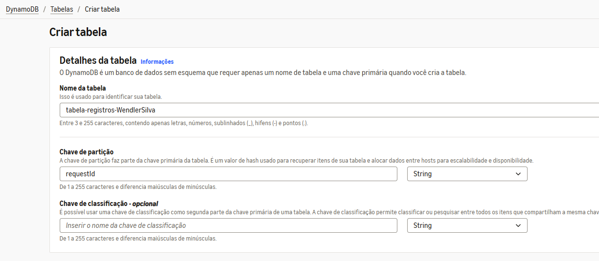

## 2. Criação da fila no Amazon SQS

Em seguida, foi criada uma fila no Amazon SQS para receber as mensagens enviadas pelo frontend.

Foi utilizado o tipo de fila Standard, mantendo as configurações padrão. Essa fila permite desacoplar o recebimento das solicitações do processamento realizado pelo backend.

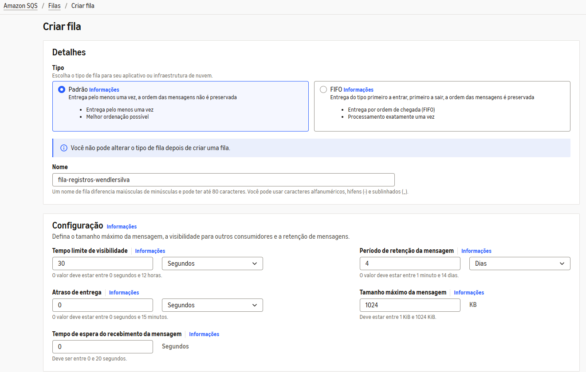

## 3. Criação dos grupos de segurança

Foram criados dois grupos de segurança para controlar a comunicação entre os componentes da arquitetura.

### 3.1. Grupo de segurança do Load Balancer

O primeiro grupo de segurança foi destinado ao Application Load Balancer.

Foi configurada uma regra de entrada permitindo tráfego HTTP pela porta 80, com origem `0.0.0.0/0`, permitindo que os usuários acessem a aplicação pela internet.

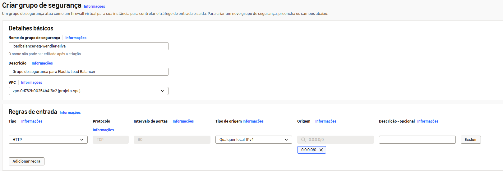

### 3.2. Grupo de segurança das instâncias EC2

O segundo grupo de segurança foi criado para as instâncias EC2.

Diferentemente do grupo do Load Balancer, a regra de entrada HTTP foi configurada para aceitar tráfego proveniente do grupo de segurança do próprio Load Balancer. Dessa forma, as instâncias frontend e backend não precisam ficar diretamente expostas à internet.

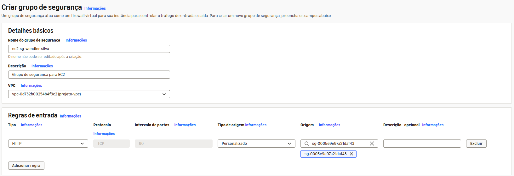

## 4. Criação da IAM Role para as instâncias EC2

Para permitir que as instâncias EC2 interajam com os serviços AWS necessários, foi criada uma IAM Role com o serviço EC2 como entidade confiável.

Essa abordagem permite que as instâncias utilizem credenciais temporárias gerenciadas pela AWS, sem a necessidade de armazenar Access Keys e Secret Keys diretamente nos servidores.

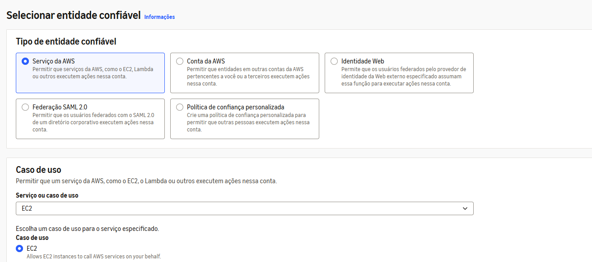

### 4.1. Permissão para acessar o DynamoDB

Foi adicionada a política gerenciada pela AWS `AmazonDynamoDBFullAccess`, permitindo que as instâncias realizem operações na tabela do DynamoDB.

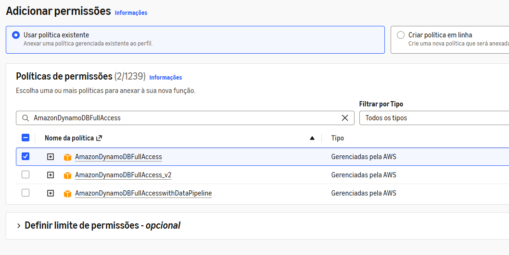

### 4.2. Permissão para acessar o SQS

Também foi adicionada a política `AmazonSQSFullAccess`, necessária para que as instâncias possam interagir com a fila de mensagens.

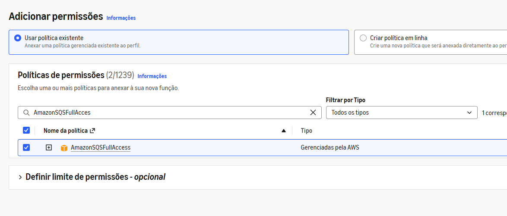

Após selecionar as políticas, foi definido o nome da função seguindo o padrão `ec2-role-<nome e sobrenome>`.

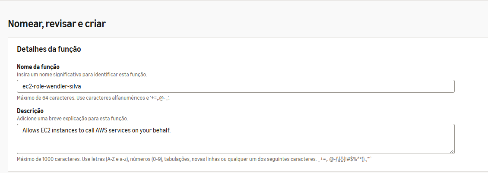

## 5. Criação das instâncias EC2 do frontend

Com os recursos de armazenamento, mensageria e permissões preparados, foi iniciada a criação das duas instâncias EC2 responsáveis pelo frontend.

Essas instâncias hospedam a aplicação web e recebem as solicitações dos usuários, encaminhando os dados para a fila do SQS.

### 5.1. Primeira instância frontend

A primeira instância foi configurada com o nome `frontend1-<nome e sobrenome>`, utilizando a imagem Amazon Linux 2023.

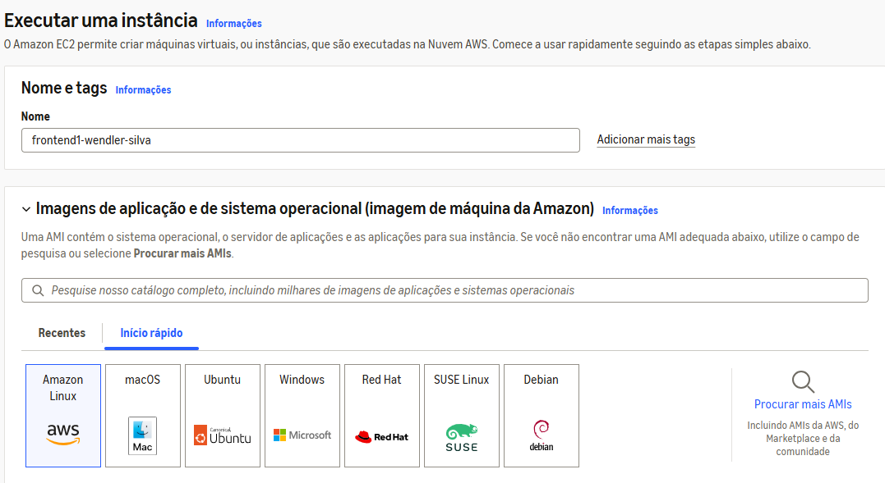

Foi selecionado o tipo de instância `t2.micro`, conforme solicitado no laboratório.

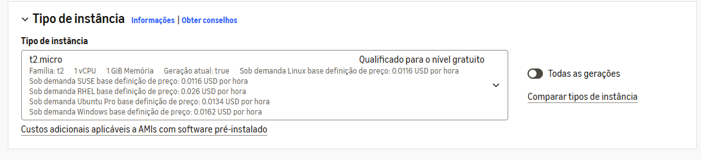

Na configuração de acesso, foi selecionada a opção de prosseguir sem um par de chaves.

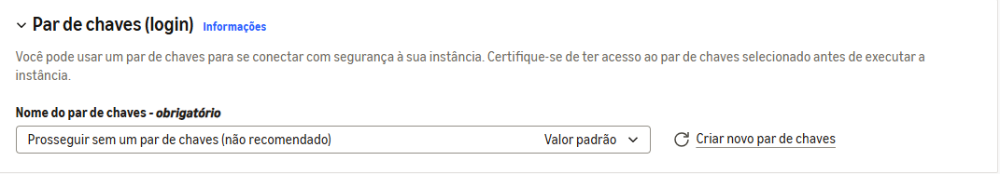

Na configuração de rede, foi selecionada a VPC `projeto-vpc` e a primeira sub-rede privada (`private1`). A atribuição automática de IP público foi desabilitada e foi associado o grupo de segurança criado anteriormente para as instâncias EC2.

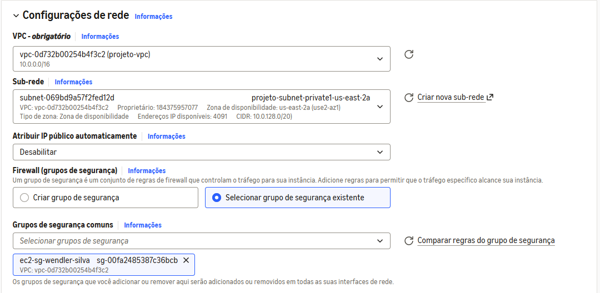

Em detalhes avançados, foi associado à instância o perfil IAM criado anteriormente.

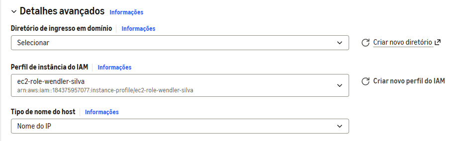

Por fim, foram inseridos os dados do usuário com o script de inicialização do frontend. Nesse script, foram configurados a região AWS e o endereço da fila SQS, além da instalação e inicialização da aplicação web.

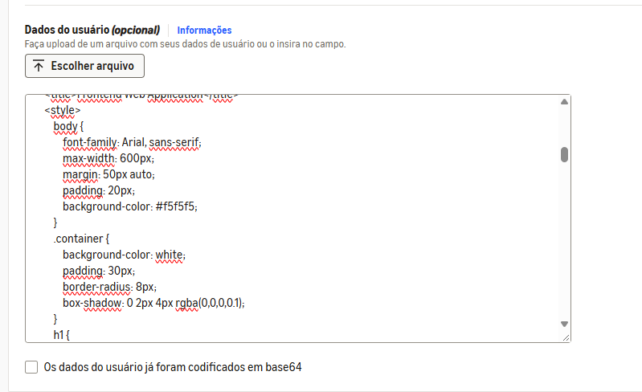

### 5.2. Segunda instância frontend

A segunda instância foi criada para trabalhar em conjunto com a primeira, permitindo que o Load Balancer distribua as requisições entre duas instâncias localizadas em sub-redes privadas diferentes.

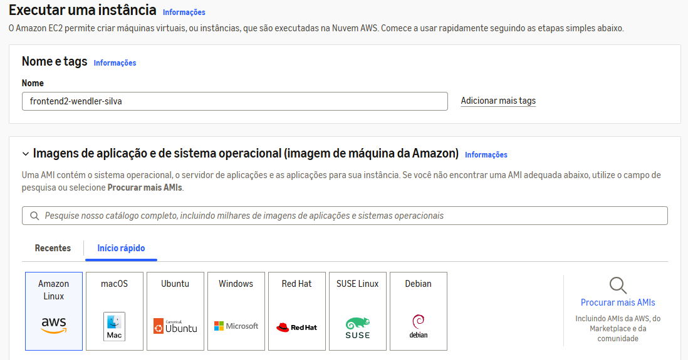

Foi utilizada a mesma imagem Amazon Linux 2023.

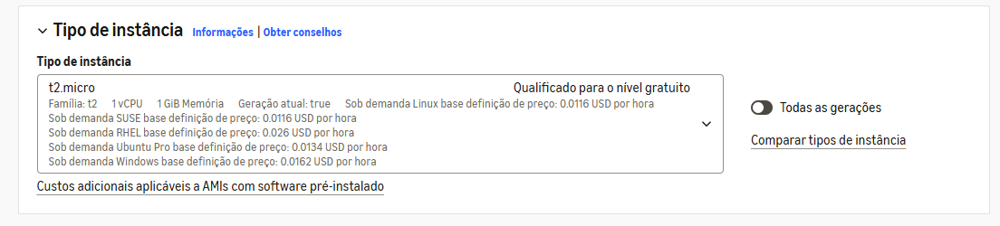

Nesta etapa, foi selecionada a opção de prosseguir sem um par de chaves.

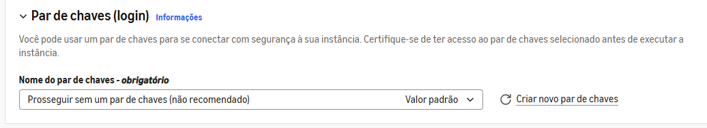

A configuração de rede utilizou a mesma VPC e o grupo de segurança das instâncias EC2, mas com a segunda sub-rede privada (`private2`). O IP público automático permaneceu desabilitado.

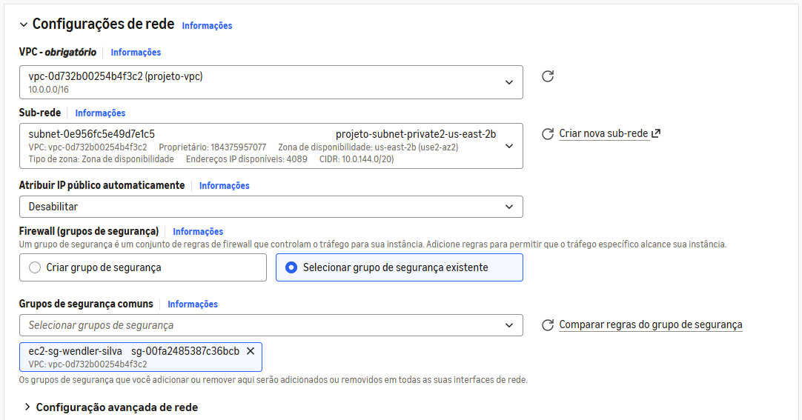

Também foi associado o perfil IAM criado anteriormente.

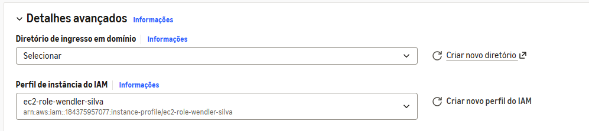

Os dados do usuário foram configurados com o mesmo script do frontend, mantendo a região AWS e a URL da fila SQS correspondentes ao laboratório.

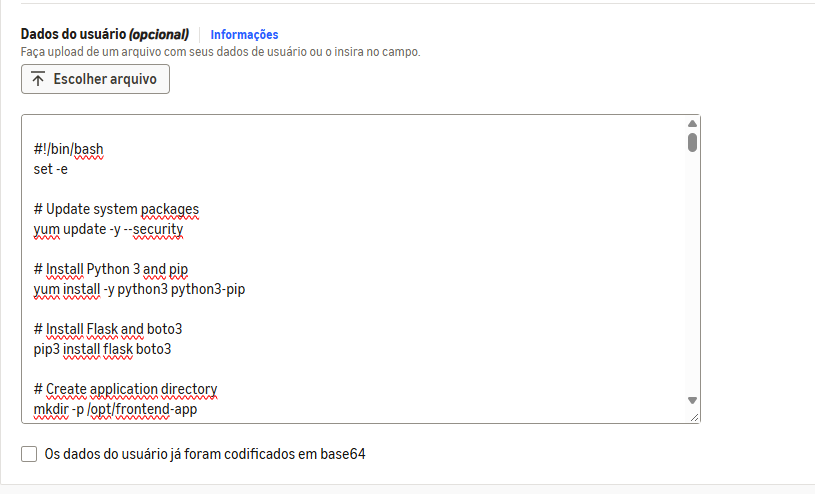

## 6. Criação do Target Group

Após iniciar as duas instâncias frontend, foi criado um Target Group para agrupar os servidores que receberão o tráfego encaminhado pelo Application Load Balancer.

O grupo foi configurado para utilizar instâncias EC2 como destinos.

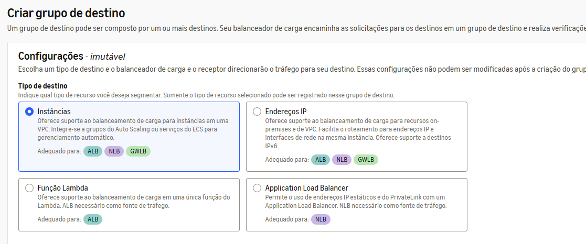

Foi definido o nome do grupo de destino seguindo o padrão `grupo-frontend-<nome e sobrenome>`.

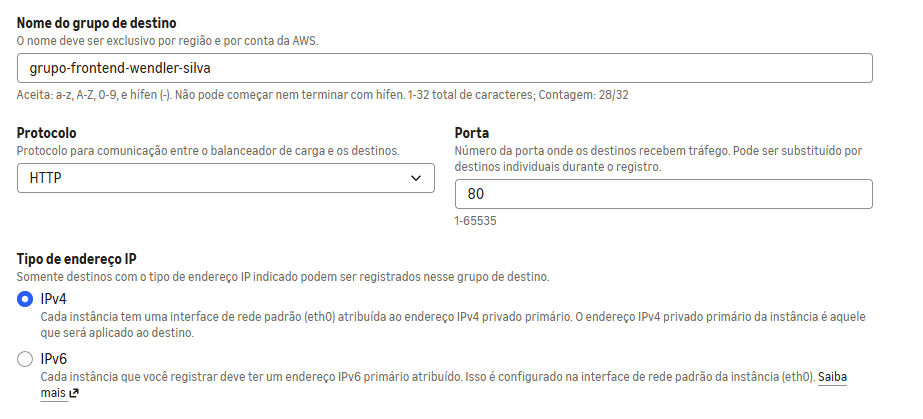

Em seguida, foi selecionada a VPC `projeto-vpc`.

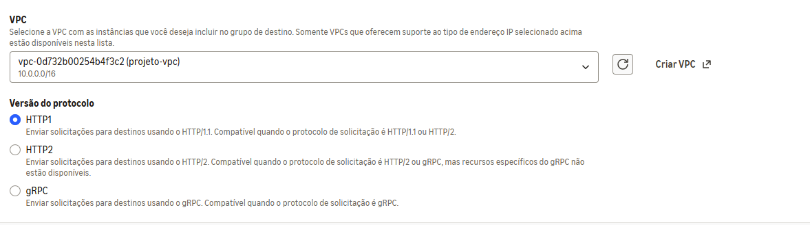

O protocolo de verificação de integridade foi configurado como HTTP, permitindo que o Load Balancer monitore a disponibilidade das instâncias.

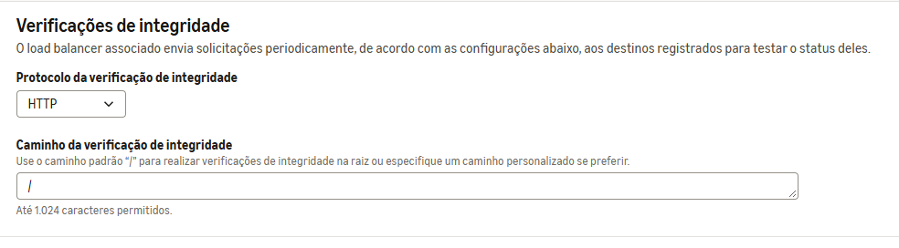

O intervalo da verificação de integridade foi configurado para 10 segundos.

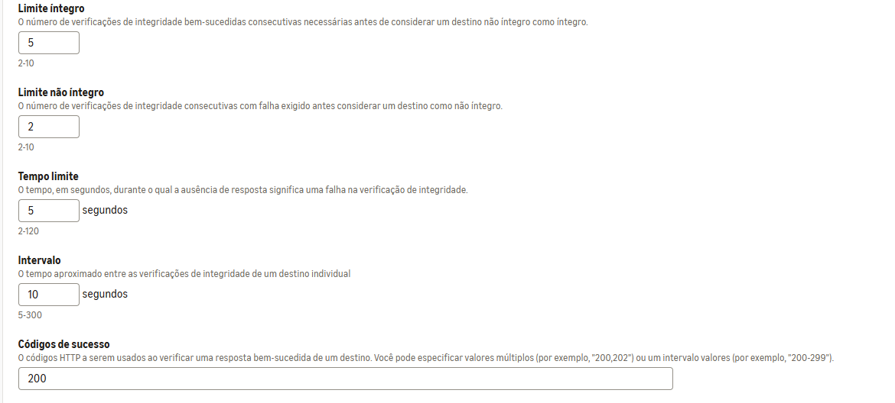

As duas instâncias frontend foram selecionadas para serem registradas como destinos do grupo.

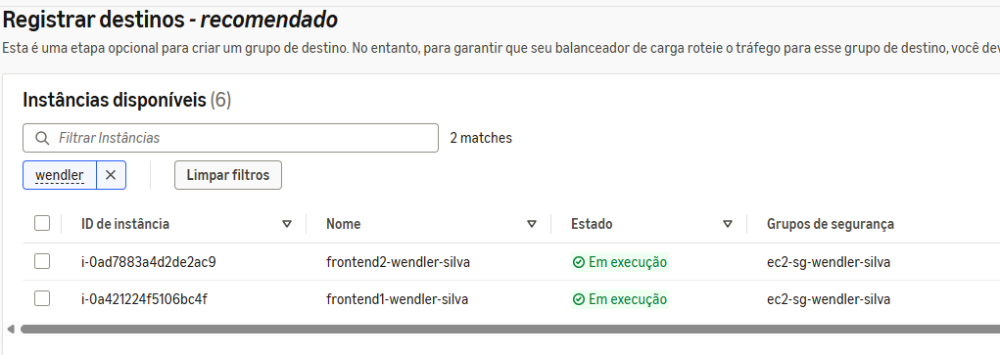

Após a seleção, as duas instâncias passaram a aparecer na lista de destinos que seriam registrados no Target Group.

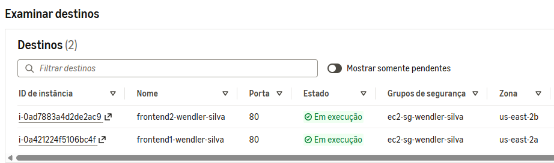

## 7. Criação do Application Load Balancer

Com o Target Group criado, foi configurado o Application Load Balancer, responsável por receber as requisições dos usuários e encaminhá-las para as instâncias frontend.

O Load Balancer foi configurado como voltado para a internet, utilizando endereçamento IPv4.

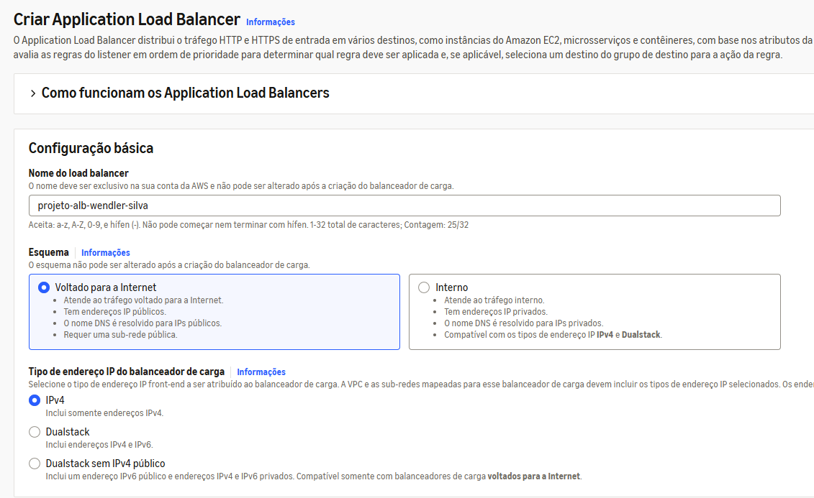

Na configuração de rede, foi selecionada a VPC `projeto-vpc`.

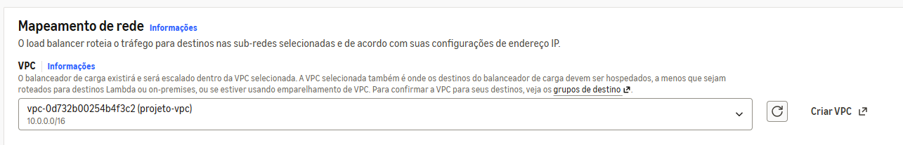

Foram selecionadas as duas sub-redes públicas (`public1` e `public2`), distribuídas entre as Zonas de Disponibilidade.

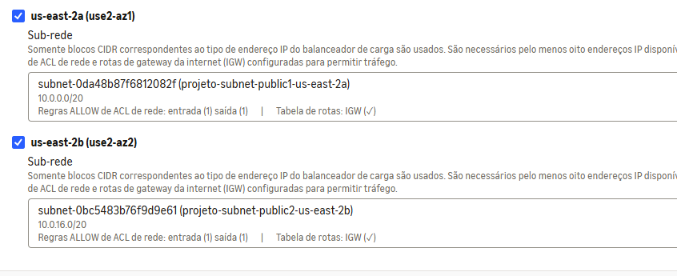

Em seguida, foi associado o grupo de segurança específico do Load Balancer, criado anteriormente.

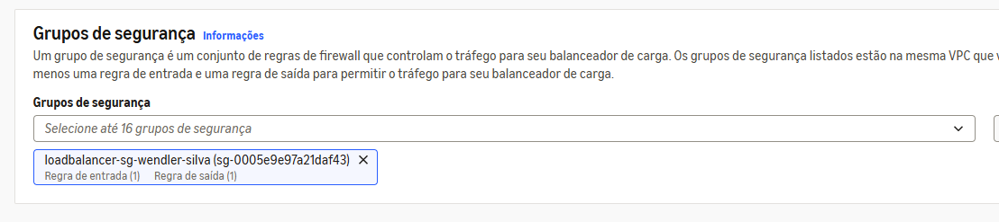

O listener foi configurado utilizando HTTP na porta 80, com encaminhamento para o Target Group do frontend.

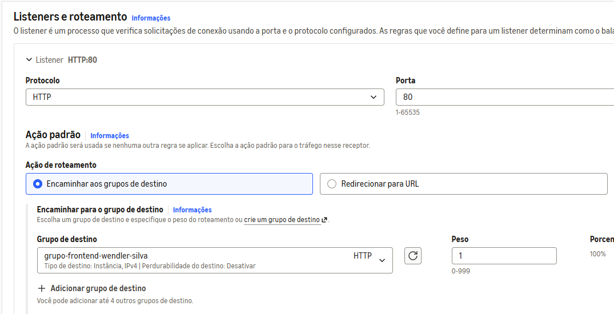

## 8. Criação das instâncias EC2 do backend

Depois de configurar a camada frontend e o Load Balancer, foi iniciada a criação das instâncias responsáveis pelo processamento das mensagens recebidas na fila SQS.

O backend consulta a fila, processa as mensagens e grava os resultados na tabela do DynamoDB.

### 8.1. Primeira instância backend

A primeira instância foi criada com o nome `backend1-<nome e sobrenome>`.

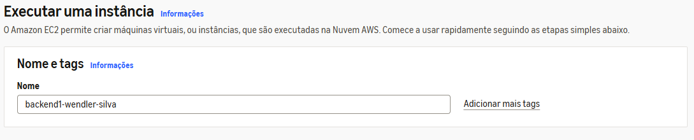

Foi selecionada a imagem Amazon Linux 2023.

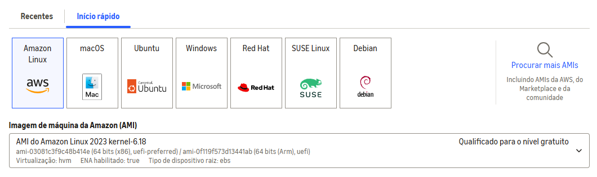

O tipo de instância utilizado foi `t2.micro`.

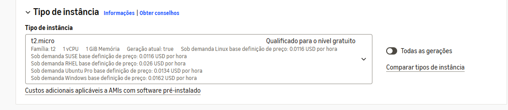

Assim como nas instâncias frontend, foi selecionada a opção de prosseguir sem um par de chaves.

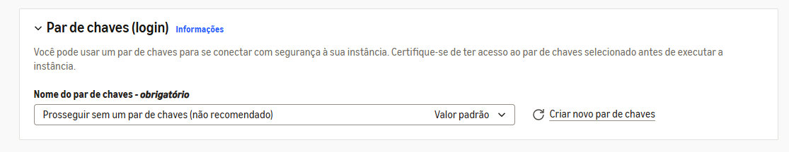

Na configuração de rede, foi utilizada a VPC `projeto-vpc` e a terceira sub-rede privada (`private3`). O IP público automático foi desabilitado e foi associado o grupo de segurança das instâncias EC2.

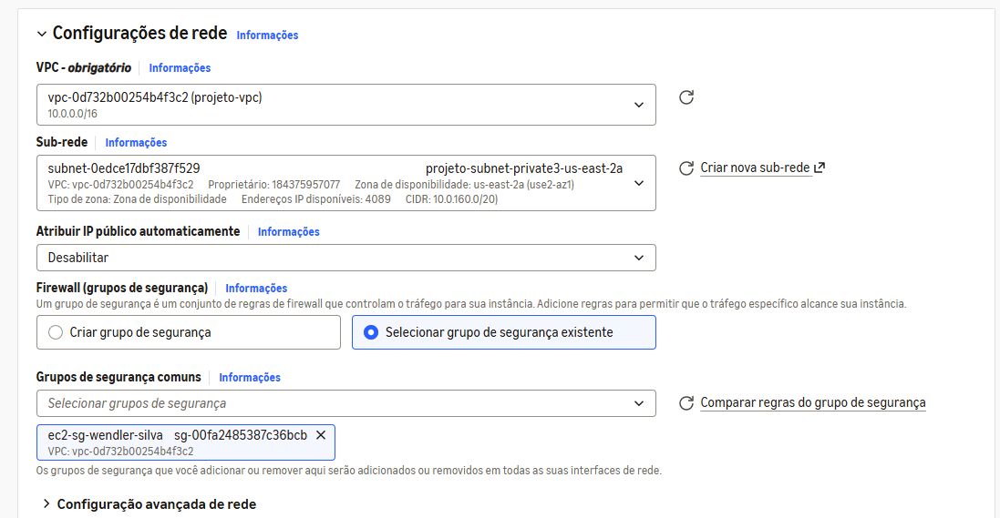

Foi associado o perfil IAM `ec2-role-<nome e sobrenome>`, permitindo o acesso aos serviços SQS e DynamoDB conforme as políticas vinculadas à função.

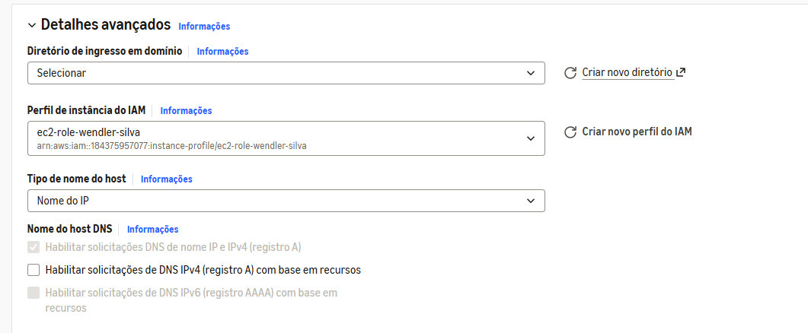

Nos dados do usuário, foi inserido o script de inicialização do backend. Foram configurados a região AWS, a URL da fila SQS e o nome da tabela DynamoDB. O script instala as dependências necessárias e prepara o serviço responsável por consumir e processar as mensagens.

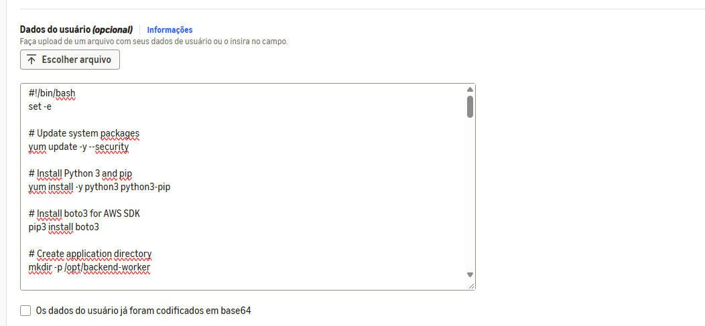

### 8.2. Segunda instância backend

Por fim, foi iniciada a criação da segunda instância backend, seguindo a mesma configuração da primeira e utilizando a quarta sub-rede privada (`private4`).

Essa distribuição permite manter as instâncias backend em sub-redes diferentes, seguindo a organização da arquitetura proposta no laboratório.

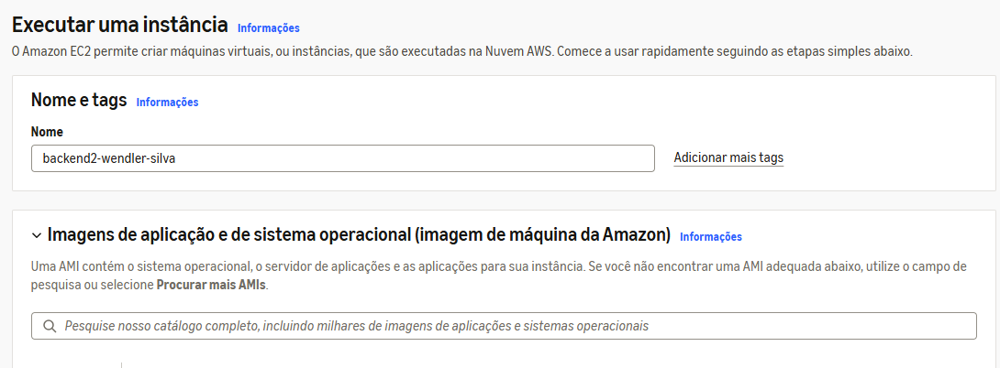

---

## 📌 Resultado parcial do Dia 1

Neste primeiro dia, foram configurados os principais componentes da arquitetura:

- Tabela do DynamoDB para armazenamento dos registros.
- Fila SQS para recebimento das solicitações.
- Grupos de segurança para controlar o tráfego entre os componentes.
- IAM Role com permissões para acesso ao SQS e DynamoDB.
- Duas instâncias EC2 para o frontend.
- Target Group para agrupar as instâncias frontend.
- Application Load Balancer para receber e distribuir as requisições.
- Duas instâncias EC2 para o backend.

A arquitetura foi preparada para permitir que o frontend receba solicitações dos usuários, envie mensagens ao SQS e que o backend consuma essas mensagens para armazenar os resultados no DynamoDB.

**Este é o registro do primeiro dia do laboratório.** A implementação e as validações das próximas etapas serão documentadas separadamente, conforme o avanço dos dias 2 e 3.