# 🚀 Dia 2 — Evolução da Arquitetura de Três Camadas na AWS

## 📌 Visão geral

No segundo dia do laboratório de Arquitetura de Aplicação Web em Três Camadas, foram realizadas melhorias na infraestrutura criada anteriormente, com foco em segurança, automação, escalabilidade e distribuição de conteúdo.

A configuração passou a utilizar o AWS Systems Manager Parameter Store para centralizar os parâmetros da aplicação, enquanto o Session Manager permitiu acessar as instâncias EC2 sem a necessidade de utilizar SSH.

Também foram criados Launch Templates e Auto Scaling Groups para as camadas de frontend e backend, além de uma distribuição Amazon CloudFront e uma Dead-Letter Queue (DLQ) para o Amazon SQS.

## 🎯 Objetivos

- Criar parâmetros no AWS Systems Manager Parameter Store.
- Atualizar as permissões da IAM Role das instâncias EC2.
- Acessar as instâncias utilizando o Session Manager.
- Modificar os códigos das aplicações frontend e backend.
- Criar Launch Templates para as duas camadas.
- Configurar Auto Scaling Groups para frontend e backend.
- Criar uma distribuição Amazon CloudFront.
- Configurar uma Dead-Letter Queue para a fila principal do SQS.

## 🛠️ Serviços AWS utilizados

- AWS Systems Manager — Parameter Store e Session Manager
- AWS IAM — Roles e políticas de permissões
- Amazon EC2 — Instâncias e Launch Templates
- EC2 Auto Scaling — Grupos de escalabilidade automática
- Elastic Load Balancing — Application Load Balancer
- Amazon CloudFront — Distribuição de conteúdo
- Amazon SQS — Filas e Dead-Letter Queue
- Amazon DynamoDB — Armazenamento dos registros

---

## 1. Criar parâmetros no AWS Systems Manager Parameter Store

Nesta etapa, foi utilizado o Parameter Store para centralizar as configurações necessárias para o funcionamento da aplicação.

Em vez de manter informações como região AWS, URL da fila SQS e nome da tabela DynamoDB diretamente nos códigos, esses valores passaram a ser armazenados como parâmetros, facilitando futuras alterações na infraestrutura.

Primeiramente, foi criado o parâmetro responsável por armazenar a região AWS utilizada no laboratório, configurado com o tipo String.

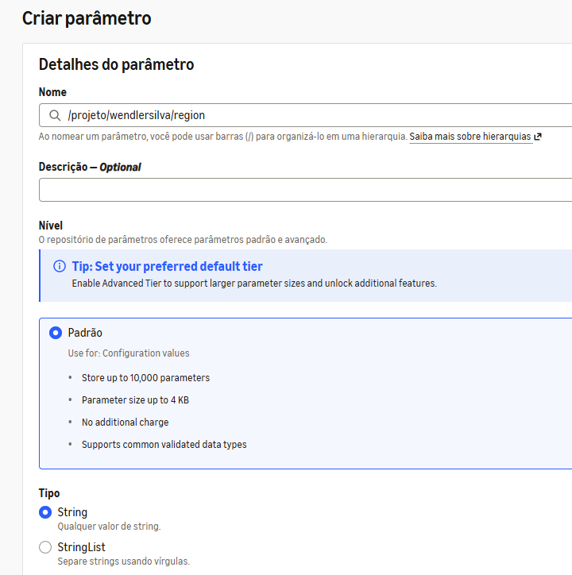

Após definir o nome do parâmetro, foi informado o valor correspondente à região AWS utilizada no projeto.

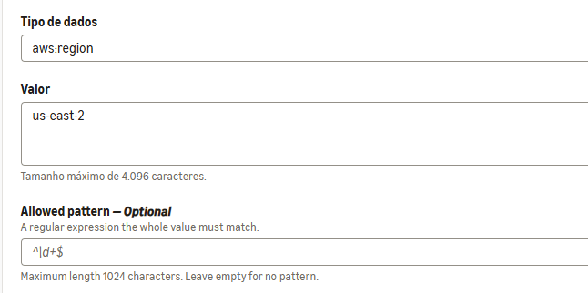

Em seguida, foi criado o segundo parâmetro, responsável por armazenar a URL da fila principal do Amazon SQS.

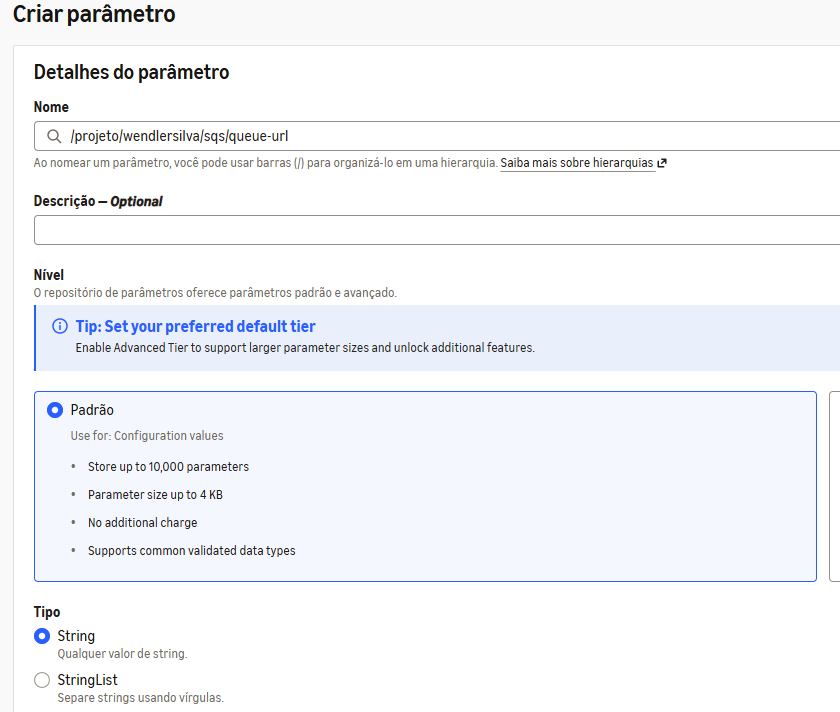

O valor configurado foi a URL da fila SQS criada no primeiro dia do laboratório.

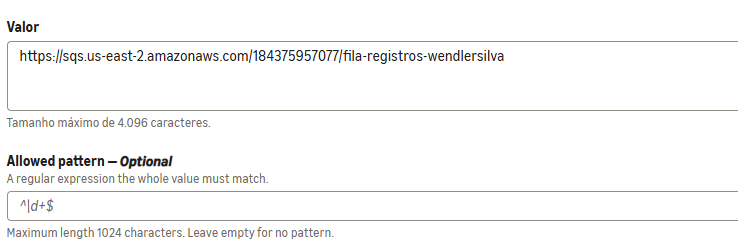

Por último, foi criado o terceiro parâmetro, destinado a armazenar o nome da tabela do Amazon DynamoDB.

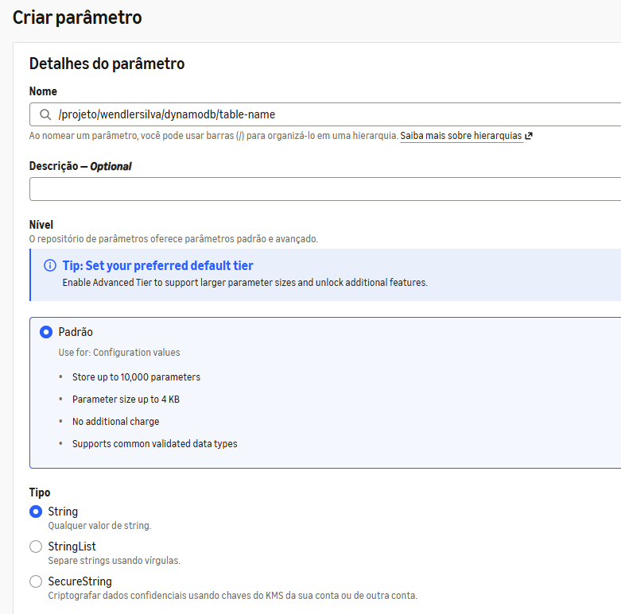

O valor informado corresponde ao nome da tabela utilizada para armazenar os registros processados pela aplicação.

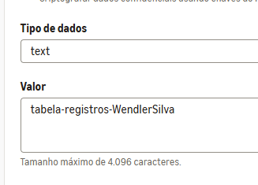

Com os três parâmetros criados, as configurações da aplicação passaram a ficar centralizadas no Parameter Store.

## 2. Atualizar as permissões da IAM Role

Para permitir que as instâncias EC2 consultem os parâmetros e sejam acessadas pelo Session Manager, foi necessário atualizar a IAM Role criada no primeiro dia.

Foi adicionada a política `AmazonSSMManagedInstanceCore`, responsável por permitir a comunicação da instância com o AWS Systems Manager e habilitar o acesso pelo Session Manager.

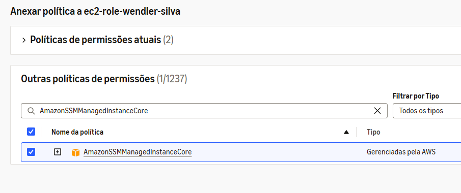

Em seguida, foi adicionada a política `AmazonSSMReadOnlyAccess`, permitindo a leitura das informações armazenadas no Systems Manager.

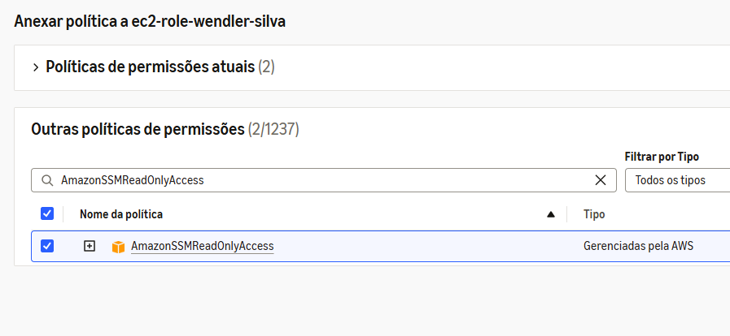

Com as permissões adicionadas, as instâncias passaram a contar com as autorizações necessárias para utilizar os recursos do Systems Manager.

## 3. Acessar as instâncias pelo Session Manager

Nesta etapa, foi utilizado o AWS Systems Manager Session Manager para acessar as instâncias EC2 de frontend e backend.

Esse recurso permite abrir um terminal diretamente pelo console da AWS, sem precisar de chaves SSH, liberar a porta 22 no Security Group ou utilizar um endereço IP público para administração.

Foi selecionada a instância EC2 de frontend no Session Manager para iniciar a sessão remota.

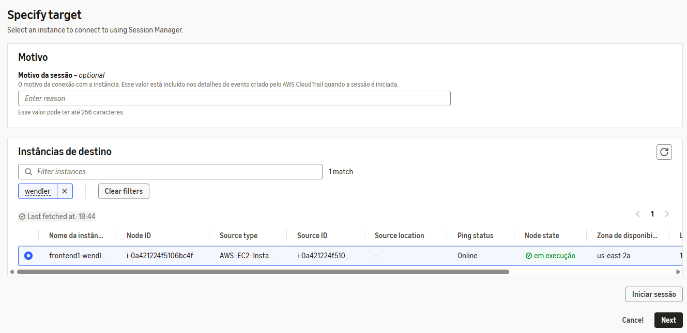

## 4. Atualizar o código do frontend

Com o acesso remoto estabelecido, foi atualizado o código da aplicação frontend.

A principal alteração foi remover a URL da fila SQS diretamente do código e implementar a consulta dinâmica ao Parameter Store utilizando o SDK Boto3.

Dessa forma, a aplicação passou a recuperar as configurações necessárias diretamente do Systems Manager.

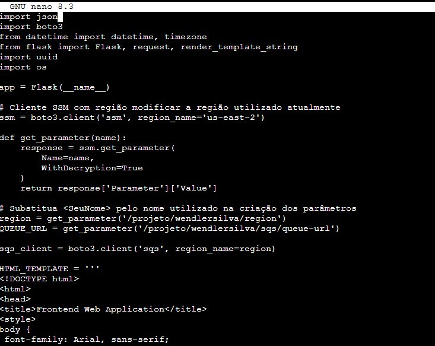

## 5. Atualizar o código do backend

O mesmo conceito foi aplicado à camada de backend.

O código do worker foi atualizado para consultar no Parameter Store as informações da região AWS, da fila SQS e da tabela DynamoDB.

Assim, o backend passou a utilizar configurações centralizadas para consumir as mensagens da fila e armazenar os registros processados no DynamoDB.

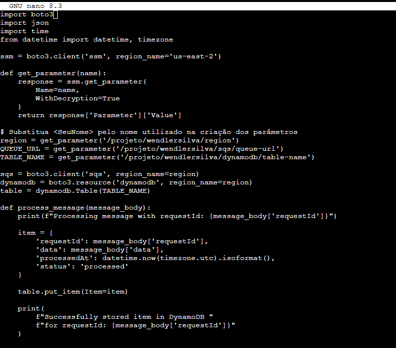

## 6. Criar Launch Templates

Após atualizar os códigos das aplicações, foram preparados os modelos de execução para as camadas de frontend e backend.

Os Launch Templates permitem padronizar as configurações utilizadas na criação de novas instâncias EC2, incluindo imagem, tipo de instância, Security Group, perfil IAM e User Data.

### 6.1. Launch Template do frontend

Foi iniciado o processo de criação do modelo de execução do frontend, utilizando as configurações necessárias para executar a aplicação web automaticamente.

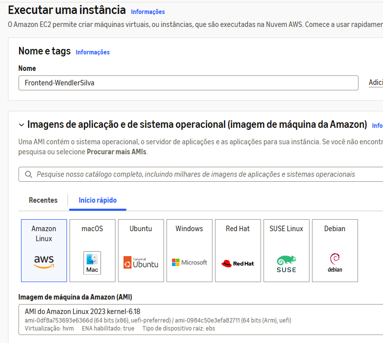

Durante a configuração, foi selecionado o grupo de segurança utilizado pelas instâncias EC2, mantendo as regras de acesso definidas anteriormente.

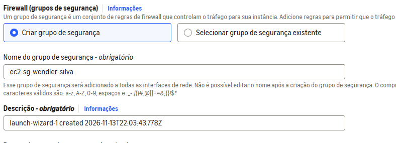

Também foi associado o perfil de instância IAM responsável por fornecer as permissões necessárias para a aplicação acessar os serviços AWS.

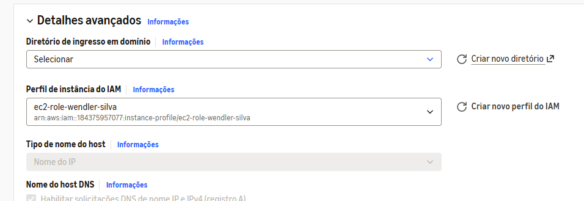

### 6.2. Launch Template do backend

Em seguida, foi preparado o modelo de execução do backend, utilizando as configurações correspondentes à aplicação responsável pelo processamento das mensagens.

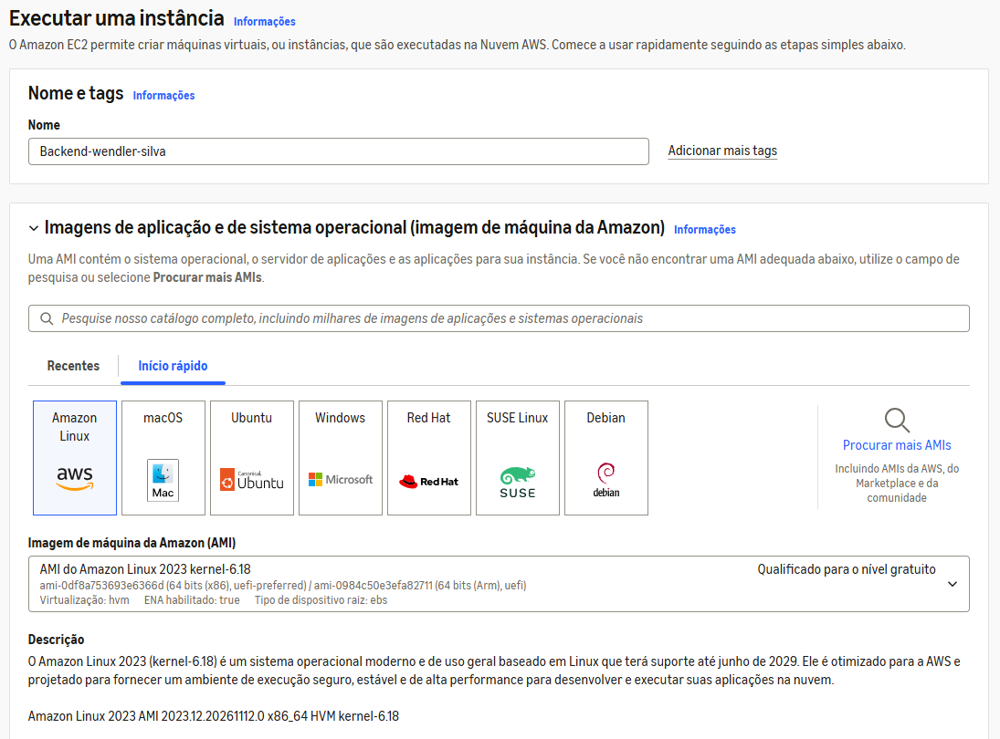

Com os modelos de execução preparados, as duas camadas passaram a contar com configurações padronizadas para a criação automática de instâncias.

## 7. Criar Auto Scaling Group do frontend

Nesta etapa, foi criado o Auto Scaling Group responsável por gerenciar automaticamente a quantidade de instâncias da camada de frontend.

Primeiramente, foi definido o nome do grupo e selecionado o Launch Template correspondente à aplicação frontend.

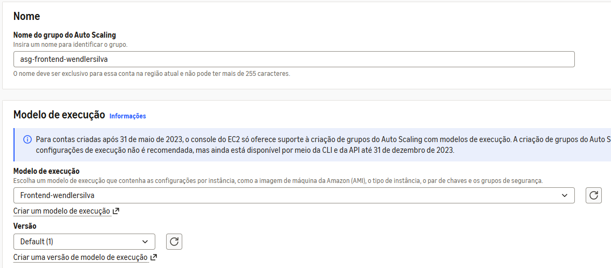

Em seguida, foi selecionada a VPC utilizada pelo projeto, mantendo a infraestrutura dentro da rede criada no primeiro dia.

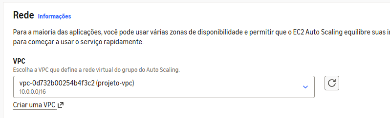

Na configuração de balanceamento de carga, foi associado o grupo de destino existente, permitindo que o Application Load Balancer encaminhe as requisições para as instâncias gerenciadas pelo Auto Scaling.

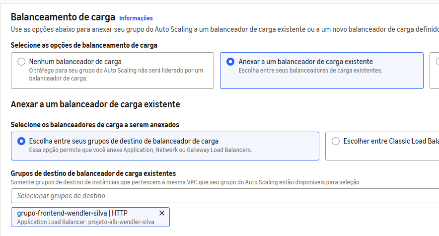

Também foram habilitadas as verificações de integridade do Elastic Load Balancing, permitindo que o Auto Scaling considere a saúde das instâncias na administração do grupo.

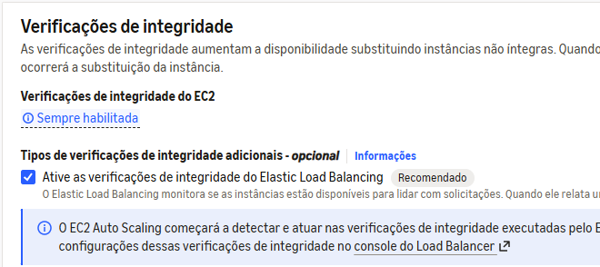

Na configuração de capacidade, foram definidos os limites de instâncias e uma política de escalabilidade baseada na utilização média da CPU, com valor de destino de 60%.

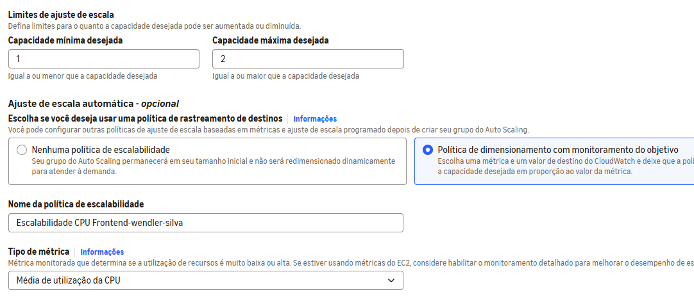

Para finalizar, foi adicionada uma etiqueta com a chave `Name`, permitindo identificar as instâncias criadas pelo grupo.

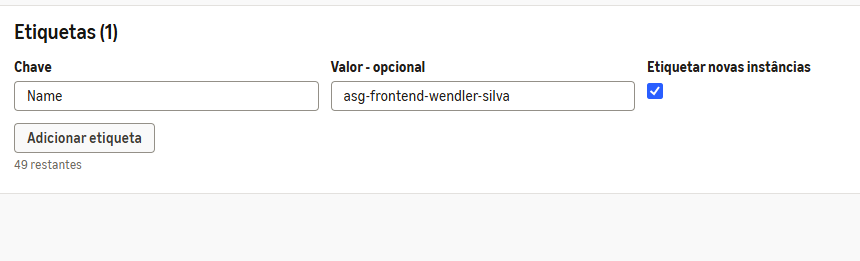

Após revisar as configurações, foi criado o Auto Scaling Group do frontend.

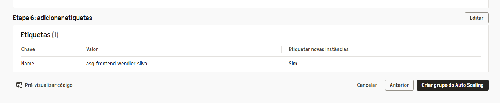

## 8. Criar Auto Scaling Group do backend

O mesmo processo foi realizado para a camada de backend, utilizando o Launch Template correspondente ao worker responsável pelo processamento das mensagens.

O grupo foi configurado para utilizar as sub-redes privadas destinadas ao backend, com capacidade mínima de uma instância e máxima de duas, além de uma política de escalabilidade baseada na utilização média da CPU, com objetivo de 60%.

Diferentemente do frontend, o Auto Scaling Group do backend não foi associado a um balanceador de carga.

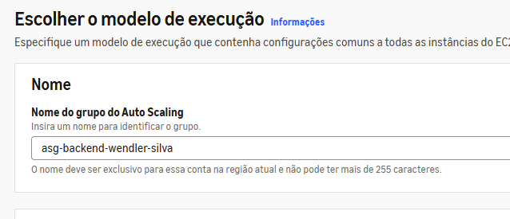

Com os dois grupos configurados, as camadas de frontend e backend passaram a contar com gerenciamento automático de capacidade.

## 9. Criar distribuição Amazon CloudFront

Para melhorar a distribuição e o acesso à aplicação, foi criada uma distribuição Amazon CloudFront.

O CloudFront utiliza o Application Load Balancer como origem, permitindo que os usuários acessem a aplicação por meio do domínio da distribuição.

Primeiramente, foi selecionado o modelo de cobrança Pay as you go durante a criação da distribuição.

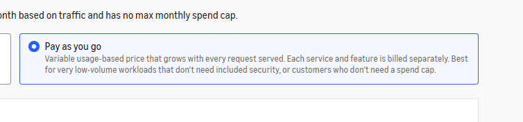

Em seguida, foi definido um nome para identificar a distribuição CloudFront.

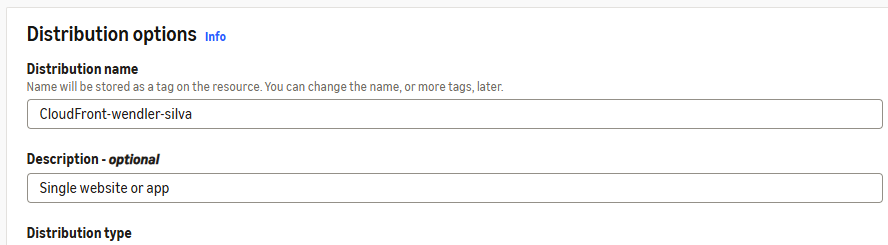

Na configuração de origem, foi selecionado o Elastic Load Balancer correspondente ao projeto. Também foi configurada a comunicação entre o CloudFront e o ALB utilizando HTTP Only, conforme a configuração do balanceador de carga do laboratório.

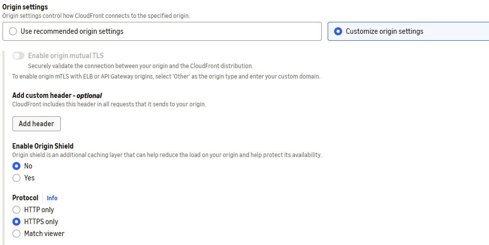

Devido aos custos adicionais, a opção de proteção do AWS WAF foi mantida desabilitada, conforme as orientações do laboratório.

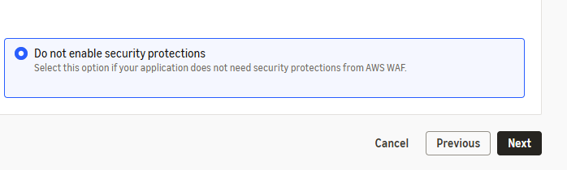

Após revisar as configurações, foi criada a distribuição CloudFront.

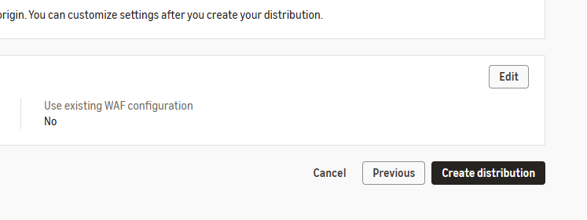

Com a distribuição implantada, foi possível utilizar o domínio fornecido pelo CloudFront para acessar a aplicação por meio de HTTPS.

## 10. Criar Dead-Letter Queue (DLQ) no Amazon SQS

A última etapa deste dia foi configurar uma Dead-Letter Queue para a fila principal do Amazon SQS.

A DLQ é utilizada para receber mensagens que não conseguiram ser processadas após um número determinado de tentativas, evitando que mensagens problemáticas continuem sendo processadas indefinidamente pela fila principal.

Primeiramente, foi criada uma nova fila SQS com o nome definido para a DLQ, período de retenção de 14 dias e tempo limite de visibilidade de 30 segundos.

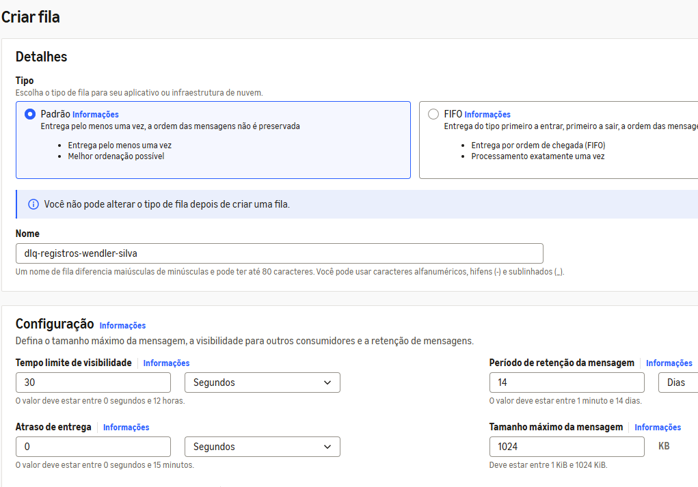

Após a criação da DLQ, a fila principal foi editada para habilitar o recurso de fila de mensagens mortas.

Foi selecionada a DLQ criada anteriormente por meio de seu ARN e definido o número máximo de recebimentos como 3.

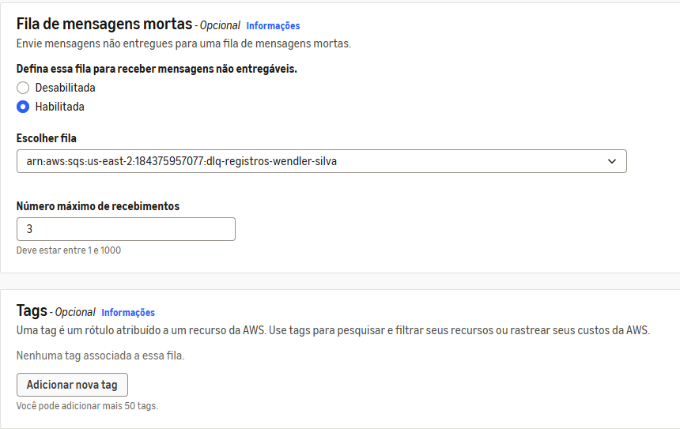

Com essa configuração, as mensagens que atingirem o limite de tentativas de processamento poderão ser encaminhadas automaticamente para a Dead-Letter Queue.

---

## 📚 Aprendizados do Dia 2

Durante esta etapa do laboratório, foram aplicados conceitos importantes de arquitetura e administração de ambientes AWS:

- Centralização de configurações utilizando o Systems Manager Parameter Store.
- Acesso remoto seguro às instâncias EC2 com Session Manager.
- Gerenciamento de permissões por meio de IAM Roles e políticas.
- Padronização da criação de instâncias com Launch Templates.
- Escalabilidade automática das camadas frontend e backend.
- Distribuição da aplicação utilizando Amazon CloudFront.
- Tratamento de mensagens com falha por meio de Dead-Letter Queue no Amazon SQS.

## ✅ Resultado

O segundo dia ampliou a arquitetura construída anteriormente, adicionando recursos de automação, escalabilidade, segurança e distribuição de conteúdo.

A infraestrutura passou a contar com configurações centralizadas, acesso administrativo sem SSH, grupos de Auto Scaling para frontend e backend, distribuição CloudFront e tratamento de mensagens não processadas por meio de uma DLQ.

**Laboratório em andamento — próximo passo: Dia 3.**