# 🚀 Dia 3 — Monitoramento, Escalabilidade e Resiliência da Arquitetura AWS

## 📌 Visão geral

No terceiro dia do laboratório de Arquitetura de Aplicação Web em Três Camadas, foram realizadas melhorias na infraestrutura criada nos dias anteriores, com foco em monitoramento, segurança, escalabilidade automática, resiliência de dados e controle de custos.

Inicialmente, foi criado um dashboard no Amazon CloudWatch para centralizar as principais métricas da arquitetura, permitindo acompanhar o comportamento do Application Load Balancer, das instâncias EC2, dos Auto Scaling Groups e das filas SQS.

Também foram configurados alarmes utilizando Amazon SNS para envio de notificações por e-mail, além de uma política de escalabilidade do backend baseada na quantidade de mensagens pendentes na fila SQS.

Por fim, foram realizados testes de carga, simulações de falhas, habilitação de recuperação de dados no DynamoDB e configuração do AWS Cost Anomaly Detection.

## 🎯 Objetivos

- Criar um dashboard no Amazon CloudWatch para monitoramento da arquitetura.
- Acompanhar métricas do Application Load Balancer, EC2, Auto Scaling e SQS.
- Restringir o acesso direto ao ALB utilizando a Managed Prefix List do CloudFront.
- Criar tópicos SNS e configurar alarmes no CloudWatch.
- Implementar escalabilidade do backend baseada no backlog do SQS.
- Realizar testes de carga e validar o funcionamento do Auto Scaling.
- Simular falhas no processamento de mensagens e validar a Dead-Letter Queue.
- Configurar o Point-in-Time Recovery no DynamoDB.
- Criar um monitor de custos utilizando AWS Cost Anomaly Detection.
- Realizar a limpeza dos recursos utilizados no laboratório.

## 🛠️ Serviços AWS utilizados

- Amazon CloudWatch — Dashboards, métricas e alarmes.
- Amazon SNS — Tópicos e notificações por e-mail.
- Amazon EC2 — Instâncias e monitoramento.
- EC2 Auto Scaling — Escalabilidade automática.
- Elastic Load Balancing — Application Load Balancer.
- Amazon CloudFront — Distribuição de conteúdo e Prefix List.
- Amazon VPC — Managed Prefix Lists e Security Groups.
- AWS Systems Manager — Run Command.
- AWS CloudShell — Execução de comandos AWS CLI.
- Amazon SQS — Filas e Dead-Letter Queue.
- Amazon DynamoDB — Point-in-Time Recovery.
- AWS Cost Anomaly Detection — Detecção de anomalias de custos.
- AWS Cost Explorer — Análise e investigação de gastos.

---

## 1. Criar um Dashboard no Amazon CloudWatch

Nesta etapa, foi criado um dashboard no Amazon CloudWatch para centralizar as principais métricas da arquitetura.

O dashboard permite acompanhar o comportamento dos serviços AWS em um único painel, facilitando a identificação de problemas e a análise da infraestrutura.

Primeiramente, foi acessado o CloudWatch, selecionada a opção Dashboards e iniciado o processo de criação de um novo painel com o nome `Dashboard-Arquitetura`.

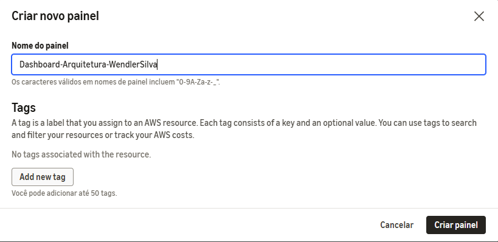

Após definir o nome, foi iniciada a configuração dos widgets. Para isso, foram selecionados CloudWatch como fonte de dados, Métricas como tipo de dados, Console de métricas como experiência preferida e Linha como tipo de visualização.

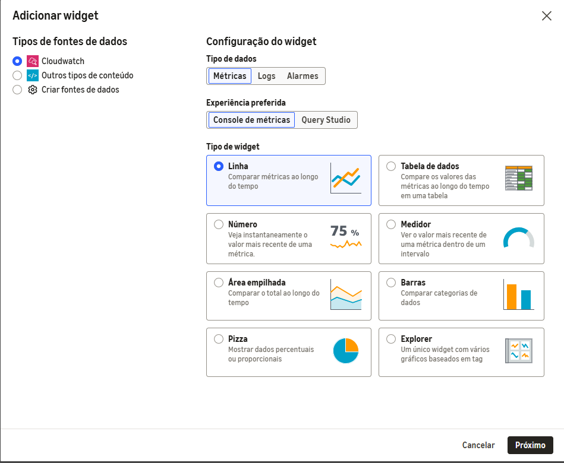

### 1.1. Adicionar métricas do Application Load Balancer

Para acompanhar as requisições recebidas pelo Application Load Balancer, foi selecionada a categoria ApplicationELB nas métricas do CloudWatch.

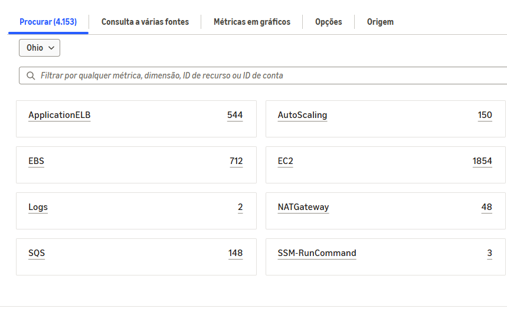

Em seguida, foi acessada a categoria `Per AppELB, per AZ, per TG Metrics`, que reúne métricas relacionadas ao Load Balancer, zonas de disponibilidade e Target Groups.

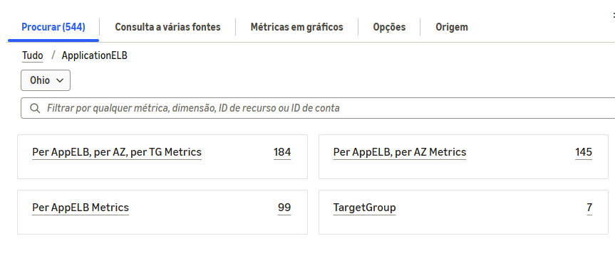

Foi localizado o Load Balancer `projeto-alb` e selecionada a métrica `RequestCount`, responsável por contabilizar a quantidade de requisições recebidas pelo balanceador.

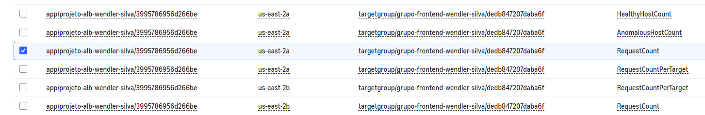

Após criar o widget, seu nome foi alterado para `Quantidade de requisições Load Balancer`, facilitando a identificação da informação apresentada no dashboard.

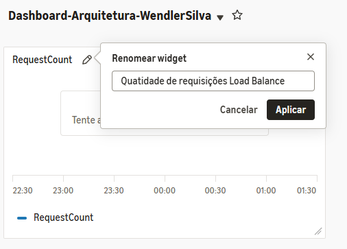

Também foi criado outro widget para acompanhar a integridade dos servidores associados ao grupo de destino do frontend.

Foram selecionadas as métricas:

- `HealthyHostCount` — quantidade de servidores saudáveis.
- `UnHealthyHostCount` — quantidade de servidores não saudáveis.

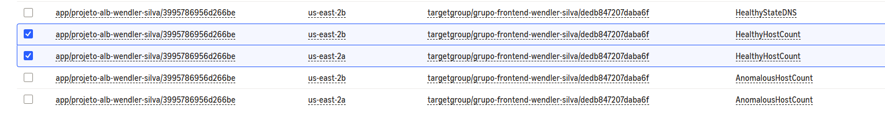

O widget foi nomeado como `Integridade do grupo de destino`, permitindo acompanhar a disponibilidade dos servidores que recebem o tráfego da aplicação.

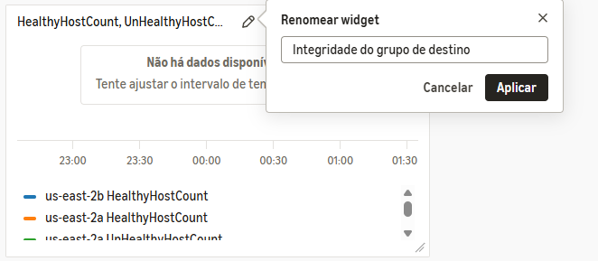

### 1.2. Habilitar métricas dos Auto Scaling Groups

Por padrão, as métricas de grupo do Auto Scaling não são publicadas no CloudWatch até que a coleta seja habilitada manualmente.

Para isso, foi acessado o Auto Scaling Group do frontend, na aba Monitoring, e habilitada a opção Group metrics collection.

O mesmo procedimento foi realizado para o Auto Scaling Group do backend.

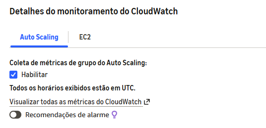

### 1.3. Adicionar métricas de CPU e instâncias em serviço

Após habilitar a coleta, foram adicionados novos widgets ao dashboard para acompanhar a utilização de CPU das instâncias.

Foi selecionada a categoria `EC2 > By Auto Scaling Group`, utilizando a métrica `CPUUtilization` dos grupos de frontend e backend.

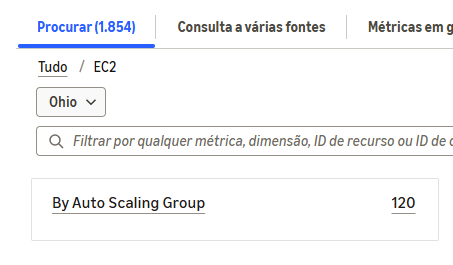

As métricas de CPU dos dois grupos foram adicionadas ao widget, permitindo acompanhar a utilização dos recursos de processamento de cada camada.

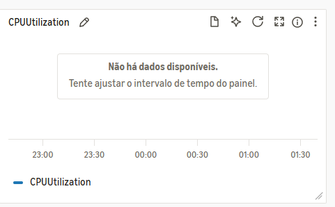

Em seguida, foi criado outro widget para acompanhar a quantidade de instâncias em serviço.

Para isso, foi acessada a categoria `AutoScaling > Group Metrics` e selecionada a métrica `GroupInServiceInstances` dos grupos de frontend e backend.

Essa métrica representa a quantidade de instâncias que estão efetivamente em serviço dentro de cada Auto Scaling Group.

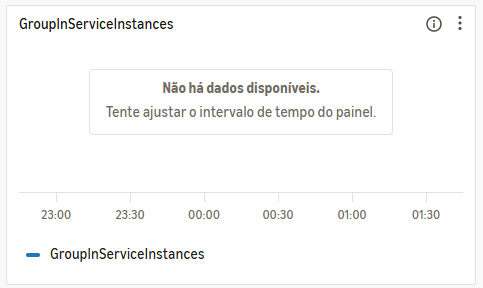

### 1.4. Adicionar métricas do Amazon SQS

Também foram adicionadas métricas das filas SQS para acompanhar o volume de mensagens pendentes e em processamento.

Na categoria `SQS > Queue Metrics`, foi localizada a fila principal e selecionadas as métricas:

- `ApproximateNumberOfMessagesVisible` — quantidade aproximada de mensagens disponíveis aguardando processamento.
- `ApproximateNumberOfMessagesNotVisible` — quantidade de mensagens recebidas por consumidores e temporariamente indisponíveis durante o processamento.


Outro widget foi criado para acompanhar a métrica `ApproximateAgeOfOldestMessage`, que indica há quanto tempo a mensagem mais antiga está aguardando processamento.

Essa informação é importante para identificar possíveis atrasos no processamento da fila.

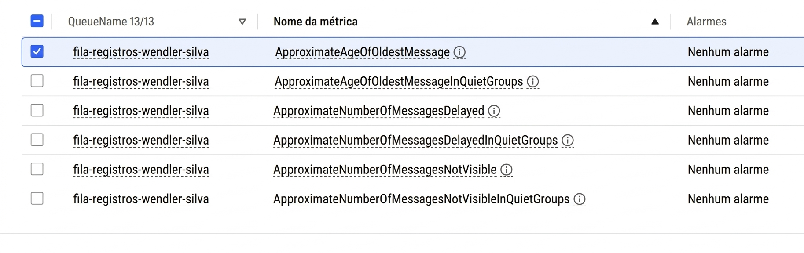

Com os widgets configurados, o dashboard passou a reunir informações sobre requisições, integridade dos servidores, utilização de CPU, quantidade de instâncias e comportamento das filas SQS.

---

## 2. Restringir o acesso ao Application Load Balancer

Nesta etapa, foi corrigida uma brecha de segurança identificada na configuração do Security Group do Application Load Balancer.

Anteriormente, a regra de entrada HTTP permitia conexões provenientes de qualquer endereço IP (`0.0.0.0/0`), possibilitando o acesso direto ao ALB sem passar pelo CloudFront.

Para corrigir isso, foi utilizada uma AWS Managed Prefix List, que contém os endereços IP utilizados pelo CloudFront para se comunicar com as origens.

Primeiramente, foi acessado o serviço VPC, na opção Managed Prefix Lists, e localizada a lista `com.amazonaws.global.cloudfront.origin-facing`.

Após identificar a Prefix List, foi copiado seu ID para utilização na regra de entrada do Security Group.

Em seguida, foi acessado o Security Group `loadbalancer-sg`, onde a regra HTTP original foi substituída por uma nova regra utilizando a Prefix List do CloudFront como origem.

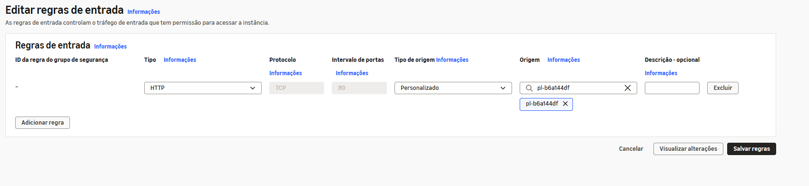

Com essa alteração, o acesso à aplicação continuou funcionando normalmente pelo CloudFront, enquanto o acesso direto pelo DNS do ALB passou a ser bloqueado pelo Security Group.

A Prefix List é mantida e atualizada automaticamente pela AWS, evitando a necessidade de atualizar manualmente os endereços IP do CloudFront.

---

## 3. Criar tópico SNS e configurar alarmes no CloudWatch

Para complementar o monitoramento da arquitetura, foi utilizado o Amazon SNS para enviar notificações por e-mail quando determinados alarmes do CloudWatch fossem acionados.

Primeiramente, foi criado um tópico SNS do tipo Standard com o nome `alertas-arquitetura`.

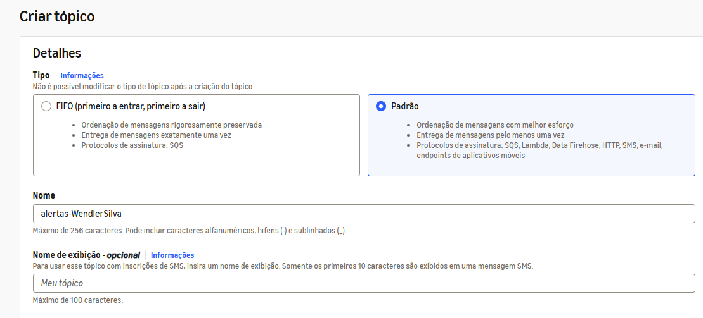

Após a criação do tópico, foi adicionada uma assinatura utilizando o protocolo E-mail, informando o endereço eletrônico que receberia as notificações.

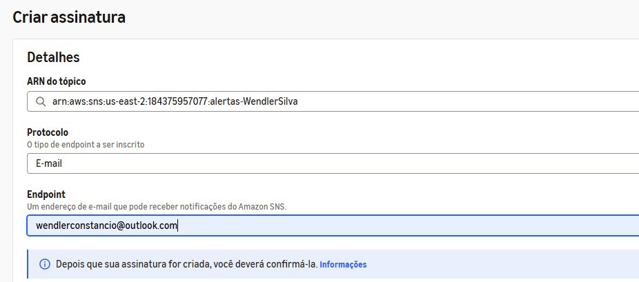

Para concluir a assinatura, foi necessário acessar o e-mail cadastrado e confirmar a inscrição por meio do link enviado pela AWS.

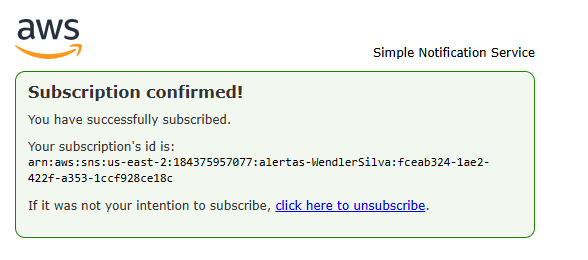

### 3.1. Criar alarme de CPU do Frontend

O primeiro alarme foi configurado para monitorar a utilização de CPU do Auto Scaling Group do frontend.

Foi selecionada a métrica `CPUUtilization` do grupo `asg-frontend`, utilizando as seguintes configurações:

- Estatística: Média.
- Período: 5 minutos.
- Tipo de limite: Estático.
- Condição: maior ou igual a 60%.

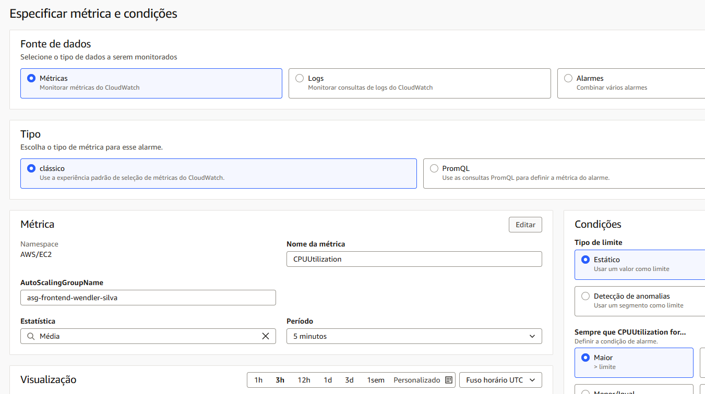

Na etapa seguinte, foi configurado o envio de notificações quando o alarme entrasse no estado Em Alarme, utilizando o tópico SNS criado anteriormente.

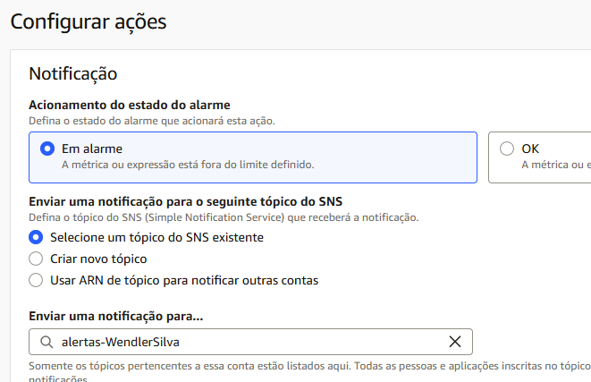

Por último, foi definido o nome `alarm-cpu-frontend` e finalizada a criação do alarme.

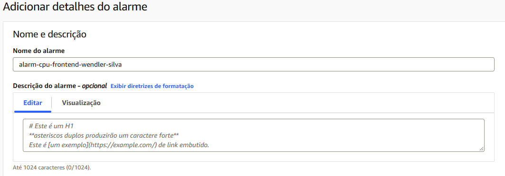

### 3.2. Criar alarme para a Dead-Letter Queue

O segundo alarme foi configurado para monitorar a Dead-Letter Queue, permitindo identificar quando mensagens com falhas de processamento fossem encaminhadas para essa fila.

Foi selecionada a métrica `ApproximateNumberOfMessagesVisible` da fila `dlq-registros`.

As configurações utilizadas foram:

- Estatística: Máximo.
- Período: 1 minuto.
- Condição: maior ou igual a 1.

Dessa forma, o alarme será acionado assim que uma mensagem estiver disponível na DLQ.

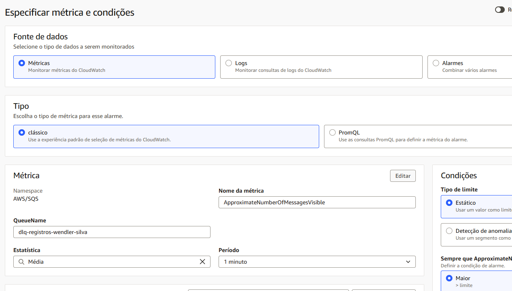

Na configuração de notificações, foi selecionado o estado Em Alarme e o tópico SNS existente, responsável por encaminhar os avisos para o e-mail cadastrado.

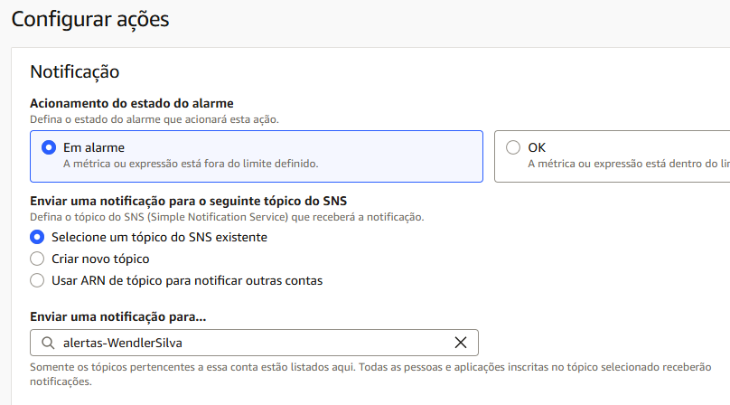

Para finalizar, foi definido o nome `alarm-dlq` e criado o alarme.

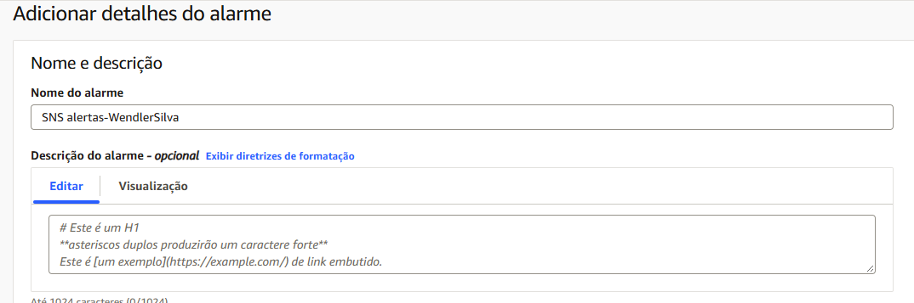

Com os dois alarmes configurados, a arquitetura passou a contar com notificações automáticas para situações de utilização elevada de CPU e mensagens encaminhadas para a Dead-Letter Queue.

---

## 4. Configurar escalabilidade do Backend baseada no backlog do SQS

No segundo dia, os Auto Scaling Groups foram configurados para realizar escalabilidade baseada na utilização de CPU.

Entretanto, para o backend, essa métrica não representa necessariamente a quantidade de trabalho pendente, pois sua principal responsabilidade é consumir mensagens da fila SQS.

Por isso, foi implementada uma política de escalabilidade baseada no backlog por instância, considerando a quantidade de mensagens disponíveis na fila e o número de instâncias em serviço.

A fórmula utilizada foi:

`Backlog por instância = mensagens disponíveis na fila ÷ instâncias em serviço`

Para implementar esse cálculo, foi utilizada a funcionalidade Metric Math do CloudWatch, que permite combinar métricas existentes por meio de expressões matemáticas.

Foram utilizadas duas métricas:

- `m1`: ApproximateNumberOfMessagesVisible, quantidade de mensagens disponíveis na fila.
- `m2`: GroupInServiceInstances, quantidade de instâncias em serviço no Auto Scaling Group.

A expressão configurada foi `m1 / m2`, permitindo calcular automaticamente o backlog médio por instância.

### 4.1. Criar política de escalabilidade do backend

Foi acessado o Auto Scaling Group `asg-backend` e removida a política anterior baseada em CPU.

Em seguida, foi criada uma nova política de escalabilidade dinâmica utilizando o tipo Target Tracking Scaling Policy.

A política foi configurada com o nome `SQS-Backlog-Backend` e o tipo de métrica Métrica personalizada do CloudWatch.

No campo de personalização da métrica, foi inserido o JSON abaixo:

```json
{
  "CustomizedMetricSpecification": {
    "Metrics": [
      {
        "Id": "e1",
        "Expression": "m1 / m2",
        "Label": "Backlog por instancia",
        "ReturnData": true
      },
      {
        "Id": "m1",
        "MetricStat": {
          "Metric": {
            "Namespace": "AWS/SQS",
            "MetricName": "ApproximateNumberOfMessagesVisible",
            "Dimensions": [
              {
                "Name": "QueueName",
                "Value": "fila-registros"
              }
            ]
          },
          "Stat": "Sum"
        },
        "Label": "Quantidade de mensagens disponiveis",
        "ReturnData": false
      },
      {
        "Id": "m2",
        "MetricStat": {
          "Metric": {
            "Namespace": "AWS/AutoScaling",
            "MetricName": "GroupInServiceInstances",
            "Dimensions": [
              {
                "Name": "AutoScalingGroupName",
                "Value": "asg-backend"
              }
            ]
          },
          "Stat": "Average"
        },
        "Label": "Quantidade de instancias em servico",
        "ReturnData": false
      }
    ]
  }
}
```

O valor de destino foi definido como 5, representando a quantidade média desejada de mensagens pendentes por instância.

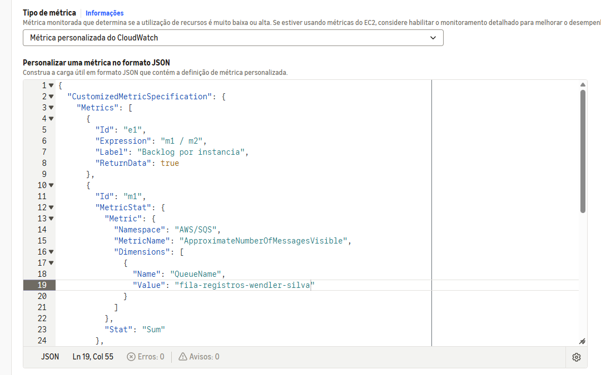

Com essa configuração, o Auto Scaling poderá adicionar ou remover instâncias conforme o comportamento do backlog por instância, respeitando os limites mínimo e máximo definidos no grupo.

---

## 5. Testar a escalabilidade baseada no SQS

Para validar a política criada, foi necessário gerar uma carga de mensagens na fila SQS e acompanhar o comportamento do Auto Scaling.

Como o backend processava as mensagens rapidamente, foi adicionada temporariamente uma pausa artificial de 10 segundos após cada processamento.

Inicialmente, foi utilizado o AWS Systems Manager Run Command, selecionando o documento `AWS-RunShellScript` e a instância do backend.

O comando executado foi:

```bash
cp /opt/backend-worker/worker.py /opt/backend-worker/worker.py.bak

sed -i "/process_message(message_body)/a\                    time.sleep(10)" /opt/backend-worker/worker.py

systemctl restart backend-worker.service
```

Essa alteração permitiu aumentar temporariamente o tempo de processamento de cada mensagem.

### 5.1. Gerar mensagens na fila SQS

Após modificar o backend, foi aberto o AWS CloudShell para executar um comando que enviaria 30 mensagens para a fila principal.

Foi utilizado o seguinte código, substituindo a URL pela URL da fila criada no laboratório.

```bash
for i in {1..30}
do
  echo "Enviando mensagem $i"

  aws sqs send-message \
    --queue-url "<URL_DA_SUA_FILA>" \
    --message-body "{\"requestId\":\"teste-$i\",\"data\":\"carga-dia-3-$i\",\"timestamp\":\"$(date -u +%Y-%m-%dT%H:%M:%SZ)\"}"
done
```

### 5.2. Acompanhar o Auto Scaling

Após o envio das mensagens, foi acessado o dashboard do CloudWatch para acompanhar o crescimento do backlog e a quantidade de instâncias em serviço.

A métrica `ApproximateNumberOfMessagesVisible` permitiu observar o acúmulo de mensagens, enquanto `GroupInServiceInstances` mostrou o aumento da quantidade de instâncias do backend conforme a política de escalabilidade era acionada.

Também foi possível verificar a criação de uma nova instância diretamente no EC2 e consultar o histórico de atividades do Auto Scaling Group.

### 5.3. Restaurar o código do backend

Após a realização do teste, a alteração temporária foi desfeita utilizando novamente o Systems Manager Run Command.

```bash
mv /opt/backend-worker/worker.py.bak /opt/backend-worker/worker.py

systemctl restart backend-worker.service
```

Com o processamento das mensagens e a redução do backlog, o Auto Scaling pôde reduzir a quantidade de instâncias, retornando ao mínimo configurado no grupo.

---

## 6. Testar a Dead-Letter Queue (DLQ)

Nesta etapa, foi realizada uma simulação de falha no processamento de mensagens para validar o encaminhamento automático para a Dead-Letter Queue.

Inicialmente, foram encerradas as instâncias de backend utilizadas no laboratório.

Em seguida, foi acessada a aplicação por meio da URL do CloudFront e realizado um novo envio de mensagem, gerando uma nova mensagem na fila principal do SQS.

Após isso, foi acessada a fila principal e simulada manualmente a atuação de um consumidor, recebendo a mensagem sem permitir que ela fosse processada corretamente.

O procedimento foi repetido até atingir três tentativas de recebimento.

Após atingir o limite configurado, a mensagem foi encaminhada automaticamente para a Dead-Letter Queue.

### 6.1. Validar o recebimento da notificação

Após aproximadamente um minuto, foi verificado o recebimento do e-mail enviado pelo SNS.

Também foi acessado o CloudWatch, na seção Alarmes, para verificar o estado do alarme `alarm-dlq`.

O alarme deveria aparecer como Em Alarme, indicando que uma mensagem havia sido encaminhada para a DLQ.

---

## 7. Testar a escalabilidade do Frontend

Para validar a escalabilidade do frontend, foi utilizado novamente o AWS Systems Manager Run Command para executar comandos diretamente na instância EC2.

O objetivo foi gerar uma carga elevada de CPU e observar o comportamento da métrica CPUUtilization no CloudWatch e da política de Auto Scaling.

Foi selecionado o documento `AWS-RunShellScript` e executado o seguinte comando:

```bash
dnf install stress-ng -y

stress-ng --cpu 0 --cpu-load 100 --timeout 9m
```

O comando instala a ferramenta stress-ng e utiliza todos os vCPUs disponíveis na instância para gerar uma carga de aproximadamente 100% de CPU durante 9 minutos.

Durante esse período, foi possível acompanhar a utilização de CPU pelo dashboard do CloudWatch e observar o comportamento do Auto Scaling Group.

Caso fosse necessário interromper o teste antes do tempo previsto, poderia ser utilizado:

```bash
pkill stress-ng
```

Esse comando encerra os processos do stress-ng, permitindo que a utilização de CPU retorne ao comportamento normal.

---

## 8. Habilitar Point-in-Time Recovery no DynamoDB

Nesta etapa, foi habilitado o Point-in-Time Recovery (PITR) na tabela do Amazon DynamoDB.

Esse recurso permite recuperar uma tabela para um ponto específico no tempo, protegendo os dados contra exclusões ou alterações acidentais.

Foi acessada a tabela `tabela-registros` e selecionada a aba Backups.

Na seção de recuperação em um ponto anterior no tempo, foi habilitada a opção Point-in-Time Recovery, utilizando o período de recuperação de backup de 1 dia.

Após salvar as configurações, a tabela passou a contar com o recurso de recuperação em um ponto no tempo.

O PITR permite recuperar os dados considerando uma janela de até 35 dias.

---

## 9. Configurar AWS Cost Anomaly Detection

Além de acompanhar a saúde da aplicação, também é importante monitorar os custos da infraestrutura.

Para isso, foi utilizado o AWS Cost Anomaly Detection, serviço que utiliza modelos de Machine Learning para identificar padrões de gastos que fogem do comportamento esperado.

Diferentemente do AWS Budgets, que trabalha principalmente com limites de gastos definidos previamente, o Cost Anomaly Detection procura identificar desvios no padrão de consumo.

### 9.1. Criar monitor de custos

Foi acessado o serviço Gerenciamento de faturamento e custos e selecionada a opção Detecção de anomalias de custo da AWS.

Após iniciar a configuração, foi acessada a aba Cost Monitors e selecionada a opção Create monitor.

Neste laboratório, foi utilizado um monitor gerenciado pela AWS, sem utilização de tags.

As configurações foram:

- Monitor name: `Anomaly-lab`.
- Método de monitoramento: Gerenciado pela AWS.
- Dimensão do monitor: Serviços da AWS — Recomendados.

O monitor gerenciado pela AWS permite acompanhar automaticamente os gastos da dimensão selecionada.

### 9.2. Criar assinatura de alertas

Após configurar o monitor, foi criada uma nova assinatura de alerta para receber notificações quando uma anomalia fosse identificada.

Foram utilizadas as seguintes configurações:

- Nome: `AnomalyAlerta`.
- Frequência: Resumos diários.
- Destinatário: endereço de e-mail cadastrado.

Para o limite de detecção, foi selecionada a opção de porcentagem acima do gasto esperado, utilizando o valor de 10%.

Com isso, o monitor e a assinatura de alerta foram criados.

**Observação:** a análise de custos pode apresentar atraso de até 24 horas. Portanto, não é necessário que uma anomalia real apareça durante a execução do laboratório.

### 9.3. Investigar anomalias utilizando Cost Explorer

Após a identificação de uma anomalia, é possível analisar informações como data de início, impacto nos custos, serviço responsável, região e tipo de utilização.

Também é possível acessar o Cost Explorer para aprofundar a investigação, utilizando diferentes formas de agrupamento:

- Por serviço, para identificar qual serviço está gerando maior custo.
- Por região, para identificar onde ocorreu o aumento.
- Por tipo de uso, para investigar qual utilização está consumindo mais recursos.

Essa análise permite compreender melhor a origem de um aumento inesperado nos custos da infraestrutura.

---

## 10. Limpeza dos recursos AWS

Após finalizar os testes e validar as configurações, foi realizada a limpeza dos recursos criados durante o laboratório, evitando cobranças desnecessárias.

A remoção foi realizada seguindo uma ordem para evitar problemas de dependência entre os serviços.

### 10.1. AWS Cost Anomaly Detection

Foram excluídos a assinatura `AnomalyAlerta` e o monitor `Anomaly-lab`.

### 10.2. CloudWatch

Foram removidos o dashboard `Dashboard-Arquitetura` e os alarmes de CPU do frontend e da DLQ.

### 10.3. SNS

Foi excluída a assinatura de e-mail e, em seguida, o tópico `alertas-arquitetura`.

### 10.4. CloudFront

A distribuição foi desabilitada e, após a conclusão desse processo, excluída.

### 10.5. DynamoDB

Foi realizada a verificação dos backups associados à tabela `tabela-registros`, removendo os recursos que podiam ser excluídos conforme as orientações do laboratório.

### 10.6. SQS

Foram excluídas a fila principal `fila-registros` e a DLQ `dlq-registros`.

### 10.7. Auto Scaling Groups

Foram excluídos os grupos:

- `asg-frontend`
- `asg-backend`

### 10.8. Launch Templates

Foram removidos os modelos de execução do frontend e backend.

### 10.9. Load Balancer

Foi excluído o Application Load Balancer `projeto-alb`.

### 10.10. Target Groups

Foi excluído o grupo de destino `grupo-frontend`.

### 10.11. Security Groups

Após aguardar o encerramento das instâncias, foram removidos os Security Groups do Load Balancer e das instâncias EC2.

### 10.12. Systems Manager Parameter Store

Foram excluídos os três parâmetros criados anteriormente:

- `region`
- `sqs/queue-url`
- `dynamodb/table-name`

### 10.13. IAM

Foi removida a função `ec2-role`.

### 10.14. CloudShell

Foi utilizada a opção de exclusão do ambiente CloudShell, conforme as orientações do laboratório.

### 10.15. Managed Prefix List do CloudFront

Não foi necessária nenhuma ação de exclusão, pois a Prefix List pertence à AWS e é gerenciada automaticamente pelo serviço CloudFront.

---

## 📚 Aprendizados do Dia 3

Durante esta etapa do laboratório, foram aplicados conceitos importantes de arquitetura e administração de ambientes AWS:

- Monitoramento centralizado utilizando dashboards do Amazon CloudWatch.
- Acompanhamento de métricas do ALB, EC2, Auto Scaling e SQS.
- Restrição de acesso ao Application Load Balancer utilizando Managed Prefix Lists.
- Configuração de notificações automáticas com Amazon SNS.
- Criação de alarmes para monitoramento de CPU e mensagens na DLQ.
- Implementação de escalabilidade baseada no backlog do SQS.
- Utilização de Metric Math para combinar métricas do CloudWatch.
- Execução de testes de carga utilizando AWS Systems Manager e stress-ng.
- Validação do encaminhamento de mensagens para a Dead-Letter Queue.
- Habilitação de Point-in-Time Recovery no DynamoDB.
- Monitoramento de anomalias de custos com AWS Cost Anomaly Detection.
- Investigação de gastos utilizando AWS Cost Explorer.

## ✅ Resultado

O terceiro dia consolidou a arquitetura desenvolvida nos laboratórios anteriores, adicionando recursos de monitoramento, segurança, escalabilidade e resiliência.

A infraestrutura passou a contar com um dashboard centralizado, notificações automáticas, alarmes de monitoramento, escalabilidade do backend baseada no backlog do SQS e mecanismos de recuperação de dados no DynamoDB.

Também foram realizados testes para validar o comportamento da arquitetura diante de aumento de demanda e falhas no processamento, além da implementação de recursos para acompanhar possíveis anomalias nos custos da AWS.

**Laboratório concluído — Arquitetura de Aplicação Web em Três Camadas na AWS.**